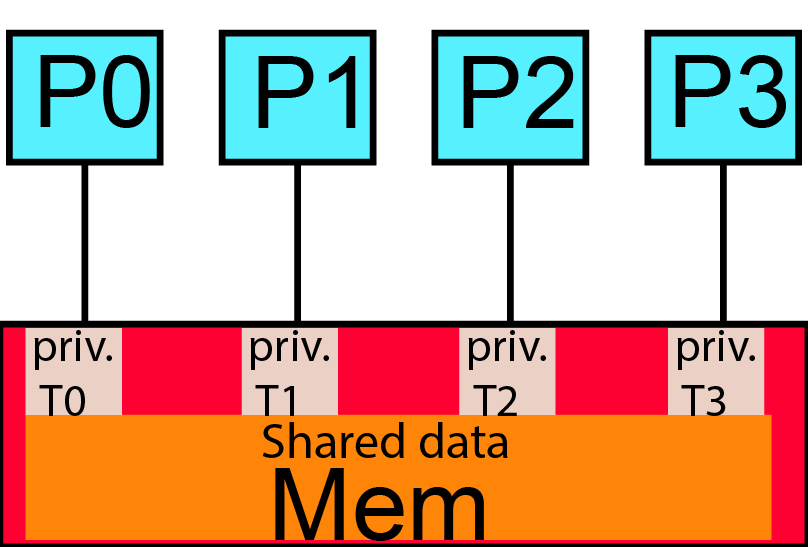

More on Private Data
====================

.. objectives::

    This guide covers special versions of private data:

    - ``firstprivate`` - initialization of private variables
    - ``lastprivate`` - capturing values from last iteration
    - ``reduction`` - parallel reductions (sums, products, etc.)
    - ``threadprivate`` - privatizing global storage
    - User-defined reductions (OpenMP 4.0+)

Private and Shared Data: Review
^^^^^^^^^^^^^^^^^^^^^^^^^^^^^^^

In a parallel region, data can be either shared or private.

**Shared Data**

- Value is retained on entry to the parallel region.
- Survives after the parallel region ends.

**Private Data**

- Each thread has its own private copy.
- Normally uninitialized at the beginning of the parallel region.
- Contents are typically lost when the parallel region finishes.
- Connections to values before and after the parallel region may nevertheless be needed.

**Memory Layout**

.. code-block:: text

   Main Memory: [Shared data]
   Thread 0: [Private T0]
   Thread 1: [Private T1]
   Thread 2: [Private T2]
   Thread 3: [Private T3]

Clause: firstprivate
--------------------

**Problem**

Private variables are not initialized by default.

**Solution: firstprivate Clause**

The ``firstprivate`` clause:

- Declares variables private for each thread.
- Initializes each private copy from the original value before the construct.

**Example: firstprivate**

.. tabs::

   .. tab:: C/C++

      .. code-block:: c

         #include <stdio.h>
         #include <omp.h>

         int main(void)
         {
             int lsum = 10;
             #pragma omp parallel firstprivate(lsum) num_threads(4)
             {
                 lsum += omp_get_thread_num();
                 printf("%i\n", lsum);
             }
             return 0;
         }

   .. tab:: Fortran

      .. code-block:: fortran

         program firstprivate_example
             use omp_lib
             implicit none
             integer :: lsum
             lsum = 10
             !$omp parallel firstprivate(lsum) num_threads(4)
                 lsum = lsum + omp_get_thread_num()
                 print *, lsum
             !$omp end parallel
         end program firstprivate_example

**Expected Output**

With four threads, the thread-local values are 10, 11, 12, and 13 (the printing order is unspecified).

.. code-block:: text

   Thread 0: 10
   Thread 1: 11
   Thread 2: 12
   Thread 3: 13

**Example: Vector Norm with private**

This computes :math:`\sqrt{\sum_i v(i)\,v(i)}` using a private partial sum per thread and an atomic update to the shared result.

.. tabs::

   .. tab:: C/C++

      .. code-block:: c

         norm = 0.0;
         #pragma omp parallel default(none) \
             shared(vect, norm, vleng) private(i, lNorm)
         {
             lNorm = 0.0;
             #pragma omp for
             for (i = 0; i < vleng; i++)
                 lNorm += vect[i] * vect[i];
             #pragma omp atomic update
             norm += lNorm;
         }
         norm = sqrt(norm);

   .. tab:: Fortran

      .. code-block:: fortran

         norm = 0.0
         !$omp parallel default(none) &
         !$omp shared(vect, norm) private(i, lNorm)
             lNorm = 0.0
             !$omp do
             do i = 1, vleng
                 lNorm = lNorm + vect(i)**2
             enddo
             !$omp atomic update
             norm = norm + lNorm
         !$omp end parallel
         norm = sqrt(norm)

.. note::

   ``lNorm`` must be initialized to 0.0 inside the parallel region, because a ``private`` copy is initially undefined. In the Fortran examples, ``vleng`` is assumed to be a named ``parameter``; if it is an ordinary variable, add it to the ``shared`` clause when using ``default(none)``.

**Example: Vector Norm with firstprivate**

This version initializes ``lNorm`` to zero before the parallel region; ``firstprivate`` then initializes every thread-local copy.

.. tabs::

   .. tab:: C/C++

      .. code-block:: c

         norm = 0.0;
         lNorm = 0.0;
         #pragma omp parallel default(none) \
             shared(vect, norm, vleng) private(i) firstprivate(lNorm)
         {
             #pragma omp for
             for (i = 0; i < vleng; i++)
                 lNorm += vect[i] * vect[i];
             #pragma omp atomic update
             norm += lNorm;
         }
         norm = sqrt(norm);

   .. tab:: Fortran

      .. code-block:: fortran

         norm = 0.0
         lNorm = 0.0
         !$omp parallel default(none) &
         !$omp shared(vect, norm) private(i) firstprivate(lNorm)
             !$omp do
             do i = 1, vleng
                 lNorm = lNorm + vect(i)**2
             enddo
             !$omp atomic update
             norm = norm + lNorm
         !$omp end parallel
         norm = sqrt(norm)

.. important::

   With ``firstprivate``, each thread's ``lNorm`` starts at 0.0, copied from the original variable. The Fortran array index runs from ``1`` through ``vleng``, corresponding to the C indexing from ``0`` through ``vleng-1``.

Clause: lastprivate
-------------------

The ``lastprivate`` clause:

- Applies to worksharing loop and sections constructs.
- Makes the specified variable private during execution.
- After the construct, copies the value from the sequentially last iteration or the last section into the original variable.
- If no value is assigned on the sequentially last iteration or section, the final value may be undefined.

A variable may appear in both ``firstprivate`` and ``lastprivate`` on a supported construct.

.. tabs::

   .. tab:: C/C++

      .. code-block:: c

         int i, a;
         #pragma omp parallel for lastprivate(a)
         for (i = 0; i < 100; i++) {
             a = i + 1;
             func(a);
         }
         printf("a=%i\n", a);   // a=100

   .. tab:: Fortran

      .. code-block:: fortran

         integer :: i, a
         !$omp parallel do lastprivate(a)
         do i = 1, 100
             a = i + 1
             call func(a)
         enddo
         print *, "a=", a     ! a=101

.. note::

   The value from the **sequentially last iteration** is assigned back to the original variable, regardless of which thread finishes last. The outputs differ because the examples use C indexing from 0 and Fortran indexing from 1.

Reduction Variables
===================

Reductions of private variables are frequently needed for averages of arrays, scalar products, sums, products, minima, and maxima.

**Previous Approach**

In the vector-norm examples we used ``atomic`` to protect updates to a shared accumulator.

**Better Approach: Reduction Clause**

For a reduction, specify the operation (addition, multiplication, logical operations, etc.) and the variable or variables. A construct may contain multiple reductions.

**Common syntax:** ``reduction(operator : variable_list)``

**How It Works**

- Each thread receives a private contribution.
- Each contribution is initialized to the identity element for the specified operation.
- At the end of the reduction region, private contributions are combined with the original value using the specified operation.
- The combined result is available after the construct.

**Example: Memory Movements for Reduction**

.. tabs::

   .. tab:: C/C++

      .. code-block:: c

         #include <stdio.h>
         #include <omp.h>

         int main(void)
         {
             int b = 5;
             #pragma omp parallel reduction(+:b) num_threads(4)
             {
                 b += omp_get_thread_num();
             }
             printf("%i\n", b);
             return 0;
         }

   .. tab:: Fortran

      .. code-block:: fortran

         program reduction_example
             use omp_lib
             implicit none
             integer :: b
             b = 5
             !$omp parallel reduction(+:b) num_threads(4)
                 b = b + omp_get_thread_num()
             !$omp end parallel
             print *, b
         end program reduction_example

**Memory Behavior (4 threads)**

.. code-block:: text

   Original value: b = 5
   Thread 0: b = 0 -> b = 0
   Thread 1: b = 0 -> b = 1
   Thread 2: b = 0 -> b = 2
   Thread 3: b = 0 -> b = 3
   Final: 5 + 0 + 1 + 2 + 3 = 11

Output: ``11``.

.. note::

   Each thread's private copy is initialized to 0 (the identity for addition) and combined at the end.

**Example: Vector Norm with atomic update**

.. tabs::

   .. tab:: C/C++

      .. code-block:: c

         norm = 0.0;
         lNorm = 0.0;
         #pragma omp parallel default(none) \
             shared(vect, norm, vleng) private(i) firstprivate(lNorm)
         {
             #pragma omp for
             for (i = 0; i < vleng; i++)
                 lNorm += vect[i] * vect[i];
             #pragma omp atomic update
             norm += lNorm;
         }
         norm = sqrt(norm);

   .. tab:: Fortran

      .. code-block:: fortran

         norm = 0.0
         lNorm = 0.0
         !$omp parallel default(none) &
         !$omp shared(vect, norm) private(i) firstprivate(lNorm)
             !$omp do
             do i = 1, vleng
                 lNorm = lNorm + vect(i)**2
             enddo
             !$omp atomic update
             norm = norm + lNorm
         !$omp end parallel
         norm = sqrt(norm)

**Example: Vector Norm with reduction**

.. tabs::

   .. tab:: C/C++

      .. code-block:: c

         norm = 0.0;  // original value
         #pragma omp parallel default(none) \
             shared(vect, vleng) reduction(+:norm) private(i)
         {
             #pragma omp for
             for (i = 0; i < vleng; i++)
                 norm += vect[i] * vect[i];  // private contribution
         }
         norm = sqrt(norm);  // combined result

   .. tab:: Fortran

      .. code-block:: fortran

         norm = 0.0  ! original value
         !$omp parallel default(none) &
         !$omp shared(vect) reduction(+:norm) private(i)
             !$omp do
             do i = 1, vleng
                 norm = norm + vect(i)**2  ! private contribution
             enddo
         !$omp end parallel
         norm = sqrt(norm)  ! combined result

.. important::

   With ``reduction(+:norm)``, no separate ``lNorm`` variable or ``atomic`` directive is needed. The clause manages private contributions and their combination.

**Example: Vector Norm with reduction (Simplified)**

The combined ``parallel for`` / ``parallel do`` construct makes the code even more concise.

.. tabs::

   .. tab:: C/C++

      .. code-block:: c

         norm = 0.0;
         #pragma omp parallel for default(none) \
             shared(vect, vleng) reduction(+:norm)
         for (int i = 0; i < vleng; i++)
             norm += vect[i] * vect[i];
         norm = sqrt(norm);

   .. tab:: Fortran

      .. code-block:: fortran

         norm = 0.0
         !$omp parallel do default(none) &
         !$omp shared(vect) reduction(+:norm)
         do i = 1, vleng
             norm = norm + vect(i)**2
         enddo
         !$omp end parallel do
         norm = sqrt(norm)

The quantity computed in all three norm approaches is :math:`\sqrt{\sum_i v(i)\,v(i)}`.

**Supported Operators (OpenMP 3.0 reference)**

.. tabs::

   .. tab:: C/C++

      .. list-table::
         :header-rows: 1
         :widths: 25 20 45

         * - Name
           - Symbol
           - Initial value of private copy
         * - Add
           - ``+``
           - 0
         * - Multiply
           - ``*``
           - 1
         * - Subtract
           - ``-``
           - 0
         * - Bitwise AND
           - ``&``
           - All bits on (``~0``)
         * - Bitwise OR
           - ``|``
           - 0
         * - Bitwise XOR
           - ``^``
           - 0
         * - Logical AND
           - ``&&``
           - 1
         * - Logical OR
           - ``||``
           - 0

   .. tab:: Fortran

      .. list-table::
         :header-rows: 1
         :widths: 25 20 45

         * - Name
           - Symbol
           - Initial value of private copy
         * - Add
           - ``+``
           - 0
         * - Multiply
           - ``*``
           - 1
         * - Subtract
           - ``-``
           - 0
         * - Logical AND
           - ``.and.``
           - ``.true.``
         * - Logical OR
           - ``.or.``
           - ``.false.``
         * - Equivalence
           - ``.eqv.``
           - ``.true.``
         * - Non-equivalence
           - ``.neqv.``
           - ``.false.``
         * - Maximum
           - ``max``
           - Smallest representable number
         * - Minimum
           - ``min``
           - Largest representable number
         * - Bitwise AND
           - ``iand``
           - All bits on
         * - Bitwise OR
           - ``ior``
           - 0
         * - Bitwise XOR
           - ``ieor``
           - 0

.. note::

   The tables reflect the OpenMP 3.0-era teaching material. Later OpenMP versions add features and clarify or change some restrictions; ``-`` as a reduction identifier is deprecated in modern specifications.

**Restrictions on Reduction**

.. tabs::

   .. tab:: C/C++

      For older OpenMP versions, the original course material notes restrictions involving arrays and pointer/reference variables.

      Modern OpenMP permits **contiguous array sections** in reduction clauses under specified restrictions. A pointer variable or C++ reference is not interchangeable with an array section.

      Use a scalar or a supported array section, and check the compiler's OpenMP version before relying on newer features.

   .. tab:: Fortran

      - ``ALLOCATABLE`` arrays must be allocated when the construct is encountered, and must not be deallocated during the reduction.
      - Pointer and assumed-size-array restrictions depend on the reduction item and OpenMP version.
      - Check the supported forms of array elements and array sections for the compiler in use.

**Order of Execution**

.. warning::

   The order in which thread contributions are combined is unspecified. Floating-point reductions can therefore give slightly different results between runs due to rounding and non-associative floating-point arithmetic. This is **not**, by itself, an OpenMP data race.

**OpenMP 4.0 Enhancement**

OpenMP 4.0 introduced the ability to declare custom reduction operations.

User-Defined Reductions
=======================

User-defined reductions allow custom combining operations, particularly useful for C/C++ ``struct`` or class objects and Fortran derived ``type`` objects.

A declaration supplies a **combiner** for merging thread-private results and optionally an **initializer** for each private contribution.

**Case Study: Maximum Value and Its Position**

Given an array, determine both its maximum value and its index. Each thread processes part of the array and contributes a maximum-value/index pair; a user-defined reduction combines those pairs.

**Step 1: Define the Data Type**

.. tabs::

   .. tab:: C/C++

      .. code-block:: c

         struct mx_s {
             float value;
             int index;
         };

   .. tab:: Fortran

      .. code-block:: fortran

         type :: mx_s
             real :: value
             integer :: index
         end type mx_s

**Step 2: Declare the Reduction**

The reduction is named ``maxloc`` and operates on ``mx_s`` objects. Here ``mx_combine`` and ``mx_init`` are user-defined helper routines.

.. tabs::

   .. tab:: C/C++

      .. code-block:: c

         #pragma omp declare reduction(maxloc: struct mx_s: \
             mx_combine(&omp_out, &omp_in)) \
             initializer(mx_init(&omp_priv, &omp_orig))

   .. tab:: Fortran

      .. code-block:: fortran

         !$omp declare reduction(maxloc: mx_s: &
         !$omp& mx_combine(omp_out, omp_in)) &
         !$omp& initializer(mx_init(omp_priv, omp_orig))

**Special variables**

- ``omp_priv``: the newly created private result to initialize.
- ``omp_orig``: the original result prior to the construct.
- ``omp_in``: a value to be combined.
- ``omp_out``: the current combined value, to update.

**Step 3: Implement the Initializer**

This initializer copies the initial value and index from the original object, as in the source material.

.. tabs::

   .. tab:: C/C++

      .. code-block:: c

         void mx_init(struct mx_s *priv, const struct mx_s *orig)
         {
             priv->value = orig->value;
             priv->index = orig->index;
         }

   .. tab:: Fortran

      .. code-block:: fortran

         subroutine mx_init(priv, orig)
             type(mx_s), intent(out) :: priv
             type(mx_s), intent(in) :: orig
             priv%value = orig%value
             priv%index = orig%index
         end subroutine mx_init

**Step 4: Implement the Combiner**

Replace the combined result if the incoming contribution has a greater value.

.. tabs::

   .. tab:: C/C++

      .. code-block:: c

         void mx_combine(struct mx_s *out, const struct mx_s *in)
         {
             if (out->value < in->value) {
                 out->value = in->value;
                 out->index = in->index;
             }
         }

   .. tab:: Fortran

      .. code-block:: fortran

         subroutine mx_combine(out, in)
             type(mx_s), intent(inout) :: out
             type(mx_s), intent(in) :: in
             if (out%value < in%value) then
                 out%value = in%value
                 out%index = in%index
             endif
         end subroutine mx_combine

.. note::

   These declaration and helper-routine fragments must be placed in appropriate program or module scope, with helper interfaces visible to the ``declare reduction`` directive. Compiler support varies: for example, GNU Fortran 14 recognizes a local ``declare reduction`` but did not resolve the same reduction imported from a separate module in a representative check.

**Step 5: Use the Reduction**

The following fragments assume the type and helper routines above are in scope, and ``val`` contains ``count`` elements.

.. tabs::

   .. tab:: C/C++

      .. code-block:: c

         struct mx_s mx;
         mx.value = val[0];
         mx.index = 0;
         #pragma omp parallel for reduction(maxloc:mx)
         for (int i = 1; i < count; i++) {
             if (mx.value < val[i]) {
                 mx.value = val[i];
                 mx.index = i;
             }
         }

   .. tab:: Fortran

      .. code-block:: fortran

         type(mx_s) :: mx
         mx%value = val(1)
         mx%index = 1
         !$omp parallel do reduction(maxloc:mx)
         do i = 2, count
             if (mx%value < val(i)) then
                 mx%value = val(i)
                 mx%index = i
             endif
         enddo
         !$omp end parallel do

- The code is similar to a serial maximum search.
- Parallel combination is abstracted behind the named reduction.
- Equal maxima may select different indices because the combiner only replaces an entry when the incoming value is strictly greater.

**Declaring a Reduction Operation: Syntax Summary**

.. tabs::

   .. tab:: C/C++

      .. code-block:: c

         #pragma omp declare reduction(reduction_identifier: type_list: \
             combiner) initializer(initializer_expression)

   .. tab:: Fortran

      .. code-block:: fortran

         !$omp declare reduction(reduction_identifier: type_list: &
         !$omp& combiner) initializer(initializer_expression)

**Components**

- ``reduction_identifier``: name for the custom reduction.
- ``type_list``: the type or types the reduction applies to.
- ``combiner``: expression or helper routine to merge contributions.
- ``initializer``: optional initialization expression or routine.

Dealing with Global Storage
===========================

By default, global storage is shared by threads. Examples include:

.. tabs::

   .. tab:: C/C++

      - File-scope variables
      - Static variables

   .. tab:: Fortran

      - ``COMMON`` blocks
      - Module data
      - Variables with the ``SAVE`` attribute

This default behavior is not always what a parallel program needs.

Directive: threadprivate
------------------------

The ``threadprivate`` directive makes eligible global or persistent storage private to each thread. Each thread has its own copy rather than using a single shared value.

.. tabs::

   .. tab:: C/C++

      .. code-block:: c

         #include <stdio.h>
         int g_var = 1;
         #pragma omp threadprivate(g_var)

         int main(void)
         {
             g_var = 4;
             #pragma omp parallel num_threads(4)
             {
                 printf("%d\n", g_var);
             }
             return 0;
         }

   .. tab:: Fortran

      .. code-block:: fortran

         module gmod
             integer :: g_var = 1
             !$omp threadprivate(g_var)
         end module gmod

         program example
             use gmod
             g_var = 4
             !$omp parallel num_threads(4)
                 print *, g_var
             !$omp end parallel
         end program example

**Expected values with 4 threads**

.. code-block:: text

   Thread 0 (primary thread): 4
   Thread 1: 1
   Thread 2: 1
   Thread 3: 1

.. note::

   Values may appear in any output order. Outside a parallel region, assignments by the initial thread affect its own ``threadprivate`` copy.

Clause: copyin
--------------

The ``copyin`` clause initializes each thread's ``threadprivate`` data from the value held by the primary thread when the parallel region begins.

.. tabs::

   .. tab:: C/C++

      .. code-block:: c

         #include <stdio.h>
         int g_var = 1;
         #pragma omp threadprivate(g_var)

         int main(void)
         {
             g_var = 4;
             #pragma omp parallel copyin(g_var) num_threads(4)
             {
                 printf("%d\n", g_var);
             }
             return 0;
         }

   .. tab:: Fortran

      .. code-block:: fortran

         module gmod
             integer :: g_var = 1
             !$omp threadprivate(g_var)
         end module gmod

         program example
             use gmod
             g_var = 4
             !$omp parallel copyin(g_var) num_threads(4)
                 print *, g_var
             !$omp end parallel
         end program example

**Output:** With four threads, **all** threads print ``4`` (in an unspecified order).

More on threadprivate
---------------------

**Data Persistence**

The original course material highlights these conditions for preserving ``threadprivate`` values between non-nested parallel regions:

- Both parallel regions have the same number of threads.
- Dynamic adjustment of the number of threads is disabled.
- Neither region is nested in another parallel region.

Use ``omp_set_dynamic`` to control dynamic adjustment:

.. tabs::

   .. tab:: C/C++

      .. code-block:: c

         #include <omp.h>
         omp_set_dynamic(0);  // disable dynamic thread adjustment

   .. tab:: Fortran

      .. code-block:: fortran

         use omp_lib
         call omp_set_dynamic(.false.)  ! disable dynamic adjustment

.. note::

   These are key conditions from the original teaching material, not an exhaustive statement of all OpenMP requirements for persistence. Do not assume thread-to-thread persistence if the runtime may change team membership.

**Threadprivate Global Storage: C/C++ and Fortran COMMON Blocks**

Fortran ``COMMON`` blocks can be made ``threadprivate``. C/C++ has no ``COMMON`` block; the analogous operation is to declare a file-scope or static variable ``threadprivate``.

.. tabs::

   .. tab:: C/C++

      .. code-block:: c

         int a, b, c;   // file-scope variables
         #pragma omp threadprivate(a, b, c)

   .. tab:: Fortran

      .. code-block:: fortran

         integer :: a, b, c
         common /abccom/ a, b, c
         !$omp threadprivate(/abccom/)

.. challenge::

    In a previous exercise, we parallelized a **for** loop which had 20 iterations by evenly divinding the 
    number of interations among the available threads. An variable was used to store the number of iterations
    in the loop and an *atomic* operation protected the data from race conditions. Rewrite this code but
    now use the *reduction* operation.

.. solution::

    .. code-block:: c
        :linenos:

        // On cluster Kebnekaise
        // ml foss
        // export OMP_NUM_THREADS=1 
        // gcc -O3 -march=native -fopenmp -o test.x 6b-forworksharing-openmp.c -lm 
        #include <stdio.h>
        #ifdef _OPENMP
        #include <omp.h>
        #endif

        int main()
        {

        int i,var1;  
        int n = 20; // number of iterations
        var1 = 0;

        #pragma omp parallel 
            {
        #ifdef _OPENMP
            // The purpose of this code is to add 1 to var1 20 times
        #pragma omp for reduction(+:var1)
            for ( int i = 0; i < n; i++)
                var1 += 1;
                
        #else
            printf("Serial code!\n");
        #endif
            }
        
            printf("var1 =  %i \n", var1);

        return 0;
        }

.. challenge::

    In the following code, monitor the values of the variables at the different stages of the runtime.

    .. code-block:: c
        :linenos:
 
        // On cluster Kebnekaise
        // ml foss
        // export OMP_NUM_THREADS=1 
        // gcc -O3 -march=native -fopenmp -o test.x 5b-datascope-openmp.c -lm 
        #include <stdio.h>
        #ifdef _OPENMP
        #include <omp.h>
        #endif

        int main()
        {

        int var1, var2, var3;   // Three variables
        var1 = 1;
        var2 = 2;
        var3 = 3;

        #pragma omp parallel firstprivate(var1,var2) shared(var3)
            {
            
        #ifdef _OPENMP
            printf("var1 =  %i , var2 = %i , var3 = %i \n",var1,var2,var3);
            var1 = 10;
            var2 = 20;
            var3 = 30;
        #else
            printf("Serial code!\n");
        #endif
            }
        
            printf("var1 =  %i , var2 = %i , var3 = %i \n",var1,var2,var3);

        int x = 0; // variable to hold the value from the last iteration

        #pragma omp parallel for lastprivate(x)
        for (int i = 0; i < 10; i++) {
            x = i; // x is private to each thread, but will retain value from the last iteration
            printf("Thread %d: i = %d, x = %d\n", omp_get_thread_num(), i, x);
        }

        printf("After the loop, x = %d\n", x); // x has the value from the last iteration (n - 1)

        return 0;
        }

.. challenge::

    In the following code, monitor the values of the variable *counter* at the different stages of the runtime.

    .. code-block:: c
        :linenos:
 
        // On cluster Kebnekaise
        // ml foss
        // export OMP_NUM_THREADS=1 
        // gcc -O3 -march=native -fopenmp -o test.x 7-threadprivate-openmp.c -lm 
        #include <stdio.h>
        #ifdef _OPENMP
        #include <omp.h>
        #endif

        // declare a global variable
        int counter;

        // this variable is private to each thread
        #pragma omp threadprivate(counter)

        int main()
        {

        counter = 0;

        #pragma omp parallel
        {
        #ifdef _OPENMP
            int thread_id = omp_get_thread_num();
            
            // Each thread sets its private copy of 'counter'
            counter = thread_id * 10;
            printf("Thread %d: counter = %d\n", thread_id, counter);

            // sync all threads
            #pragma omp barrier

            // Modify the thread-private variable
            counter += 5;
            printf("Thread %d after modification: counter = %d\n", thread_id, counter);
        #else
            printf("Serial code!\n");
        #endif
            }
        
        // Outside the parallel region, the main thread's 'counter' value is unaffected
            printf("In main thread, counter = %d\n", counter); 

        #pragma omp parallel
        {
        #ifdef _OPENMP
            int thread_id = omp_get_thread_num();
            
            // print the value of 'counter' in another parallel region
            printf("Thread %d: counter = %d in the second parallel region\n", thread_id, counter);

        #else
            printf("Serial code!\n");
        #endif
            }
        
        return 0;
        }

Summary
^^^^^^^

This guide covered special private variables in OpenMP:

*Special Private Variable Types*

- **firstprivate:** Initialization of private variables from master thread
- **lastprivate:** Set value of private variable to value of last loop iteration or last section at end of construct
- **reduction:** Calculating sums, products, etc. in parallel
- **threadprivate:** Privatize global storage

*User-Defined Reductions*

- Available in OpenMP 4.0+
- Useful for complex data types
- Requires combiner and initializer functions

*When to Use Standard Constructs*

The above constructs handle standard situations. For special cases, use:

- Explicit initialization of private variables from shared variables
- ``atomic``/``critical`` for writes to shared variables