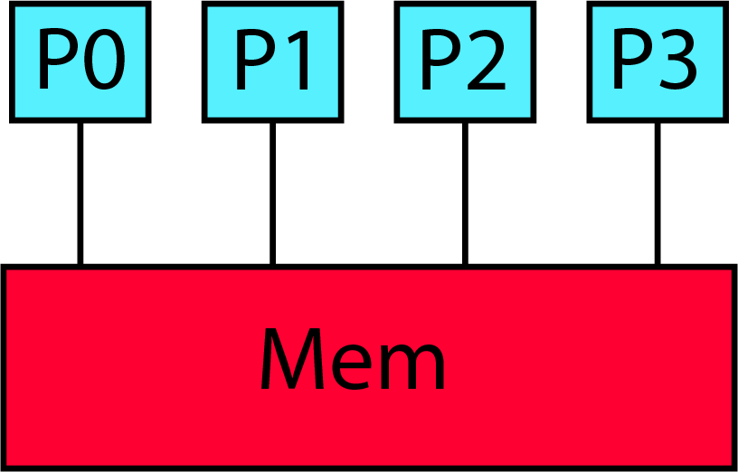
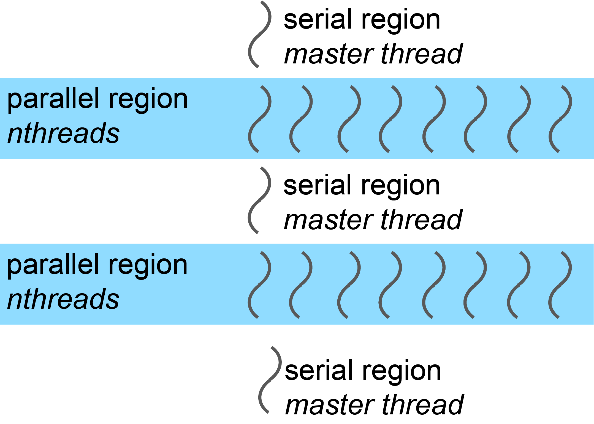
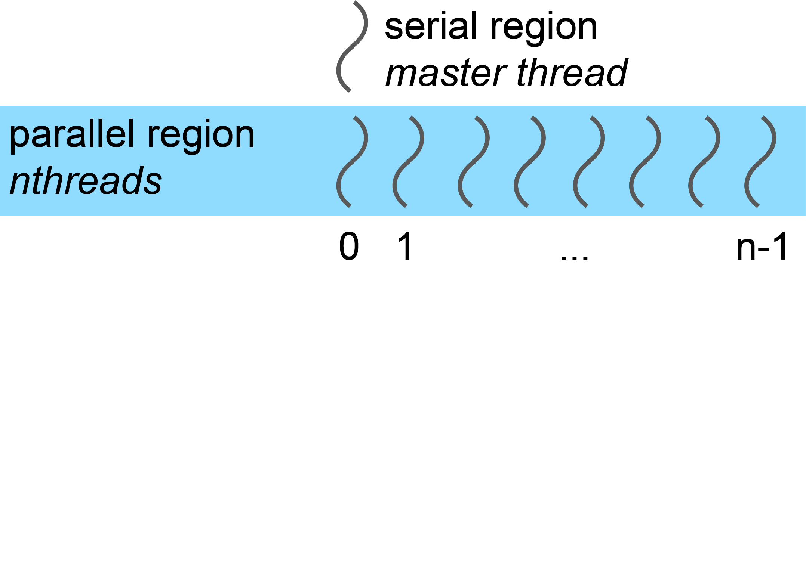

First Steps in OpenMP
=====================

.. objectives::
    
    - Parallel and serial regions
    - Master thread and teams of threads
    - Directives and library functions
    - Controlling the number of threads
    - Timing OpenMP codes

Shared Memory Programming
^^^^^^^^^^^^^^^^^^^^^^^^^

Shared memory programming is widely deployed in scientific computing due to the prevalence of multicore processors and 
multithreaded processing cores.

**Historical Context**

- Shared memory hardware was very expensive 20 years ago
- Inexpensive these days
- Contemporary laptops have between 2 and 8 cores

**Programming Options**

There are several ways to program shared memory systems:

- **Posix threads** (typically C, C++)
- **OpenMP** (C, C++, Fortran)
- **Threaded languages** (e.g., Java)

Shared Memory Architecture
^^^^^^^^^^^^^^^^^^^^^^^^^^

In shared memory architecture, threads placed on several processing elements manipulate the same shared memory space.

----

**Advantages:**

- Easy to move data between threads
- Write result to shared memory on one processor
- Read on a different processor

**Considerations:**

- Care is needed regarding order (e.g., P0 needs to write before P2 can read)
- Read/write to shared memory has typically higher cost than manipulating registers/cache
- This creates communication overhead

OpenMP Resources
^^^^^^^^^^^^^^^^

**Official Resources**

- OpenMP is trademarked by the OpenMP ARB (a not-for-profit corporation)
- Website: http://openmp.org
- Standard specifications (free): http://www.openmp.org/specifications/

**Free Tutorials**

- YouTube playlist: https://www.youtube.com/playlist?list=PLLX-Q6B8xqZ8n8bwjGdzBJ25X2utwnoEG
- LLNL tutorial: https://computing.llnl.gov/tutorials/openMP/

**Textbooks**

1. **Using OpenMP** (OpenMP 2.5)
   
   :Authors: B Chapman, G Jost, R van der Pas
   :Publisher: MIT Press, Cambridge, Massachusetts, 2008

2. **Using OpenMP – The next Step** (OpenMP 4.5)
   
   :Authors: R van der Pas, E Stolzer, C Terboven
   :Publisher: MIT Press, Cambridge, Massachusetts, 2017

Threads in OpenMP
^^^^^^^^^^^^^^^^^

**Execution Model**

Program execution follows a fork-join model:

1. **Start:** Program execution starts single-threaded (master thread)
2. **Fork:** When entering a parallel region, a team of threads is created
3. **Parallel work:** Each thread executes an independent instruction stream
4. **Join:** At the end of parallel region, threads join and synchronization occurs
5. **Continue:** Single thread continues execution

Different parallel regions can have different numbers of threads.

----

**OpenMP: Directive Based**

OpenMP is based on compiler directives that control parallel execution.

- **In Fortran:** Directives are special comments
- **In C/C++:** Directives are ``#pragma`` statements
- Directives are ignored by compilers without OpenMP support or when OpenMP is not enabled
- This makes it easy to maintain a single source version for both serial and parallel execution
- OpenMP also facilitates conditional compilation

.. tabs::

   .. tab:: C/C++

      **OpenMP Directives in C/C++**

      OpenMP directives in C/C++ use the following syntax:

      .. code-block:: c

         #pragma omp directive_name [clause ...]

      **Line Continuation**

      Use a backslash (``\``) for line continuation.

      For example:

      .. code-block:: c

         #pragma omp parallel \
             shared(a,b)

   .. tab:: Fortran

      **OpenMP Directives in Fortran**

      *Free Format*

      .. code-block:: fortran

         !$omp directive_name [clause ...]

      *Fixed Format*

      Directives always start in column 1:

      .. code-block:: fortran

         !$omp directive_name [clause ...]
         c$omp directive_name [clause ...]
         *$omp directive_name [clause ...]

      The first piece (e.g., ``!$omp``) is called
      the **sentinel**.

      **Line Continuation**

      *Free format example:*

      .. code-block:: fortran

         !$omp parallel do &
         !$omp shared(a,b)

      *Fixed format example:*

      .. code-block:: fortran

         c$omp parallel do
         c$ompa shared(a,b)
         c$ompb schedule(dynamic)

      .. note::

         A non-blank character in column 6 marks
         a continuation line.

**Directive components**

- **Directive name:** Specifies the action.
- **Clause(s):** Allow further specification.

Library Functions
^^^^^^^^^^^^^^^^^

In addition to directives, OpenMP offers library functions mainly to control the operating environment.

**Including Headers**

.. tabs::

   .. tab:: C/C++

      **In C/C++:**

      .. code-block:: c

         #include <omp.h>

   .. tab:: Fortran

      **In Fortran:**

      .. code-block:: fortran

         include "omp_lib.h"

      or

      .. code-block:: fortran

         use omp_lib

Conditional Compilation
^^^^^^^^^^^^^^^^^^^^^^^

OpenMP compilers define the preprocessor macro ``_OPENMP``.

.. tabs::

   .. tab:: C/C++

      **C Example**

      .. code-block:: c

         #ifdef _OPENMP
         #include <omp.h>
         #endif

   .. tab:: Fortran

      **Fortran Example**

      Lines starting with ``!$`` (free format) or
      ``!$``, ``*$``, ``c$`` (fixed format)
      are only compiled if OpenMP is active:

      .. code-block:: fortran

         !$ use omp_lib

.. note::

   This guard is required if code needs to be
   compiled serially.

The ``parallel`` Construct
--------------------------

The most important construct in OpenMP.

.. tabs::

   .. tab:: C/C++

      **The ``parallel`` Construct in C/C++**

      .. code-block:: c

         #pragma omp parallel
         {
             structured block of C instructions
         }

      - Starts a team of threads working on the block
        enclosed with ``{ }`` in parallel.
      - At the end of the parallel region, there's an
        implicit synchronization (wait for the last thread).

      **First Example**

      .. code-block:: c

         int main()
         {
             printf("3+5=%i\n", 3+5);
             #pragma omp parallel
             {
                 printf("6+7=%i\n", 6+7);
             }
             return 0;
         }

      **Execution:**

      - First portion executed on master thread
        (prints "3+5=" once).
      - Parallel construct creates threads.
      - Each thread performs addition and prints "6+7=".

   .. tab:: Fortran

      **The ``parallel`` Construct in Fortran**

      .. code-block:: fortran

         !$omp parallel
             structured block of Fortran
         !$omp end parallel

      - Starts a team of threads working on the block
        between the directives.
      - At the end of the parallel region, there's an
        implicit synchronization (wait for the last thread).

      **First Example**

      .. code-block:: fortran

         program example
             implicit none
             print *, "3+5=", 3+5
             !$omp parallel
             print *, "6+7=", 6+7
             !$omp end parallel
         end program example

      **Execution:**

      - First portion executed on master thread
        (prints "3+5=" once).
      - Parallel construct creates threads.
      - Each thread performs addition and prints "6+7=".
      - Code also compiles serially (without OpenMP).

Controlling the Number of Threads
---------------------------------

The number of threads started by a parallel construct can be controlled in
several ways (listed by increasing priority):

1. **Environment variable**

   This setting applies to both C/C++ and Fortran:

   .. code-block:: bash

      export OMP_NUM_THREADS=n

2. **Function call**

   .. tabs::

      .. tab:: C/C++

         .. code-block:: c

            omp_set_num_threads(n);

      .. tab:: Fortran

         .. code-block:: fortran

            call omp_set_num_threads(n)

3. **Clause on the parallel construct (highest priority)**

   .. tabs::

      .. tab:: C/C++

         .. code-block:: c

            #pragma omp parallel num_threads(n)

      .. tab:: Fortran

         .. code-block:: fortran

            !$omp parallel num_threads(n)

Thread Number and Thread ID Query Functions
^^^^^^^^^^^^^^^^^^^^^^^^^^^^^^^^^^^^^^^^^^^

The OpenMP runtime provides functions to query the number of threads and the
current thread's ID. Include the appropriate OpenMP header or module.

.. tabs::

   .. tab:: C/C++

      .. code-block:: c

         #include <omp.h>

         /* Inside a parallel region: */
         int nthreads = omp_get_num_threads();
         int thread_id = omp_get_thread_num();

   .. tab:: Fortran

      .. code-block:: fortran

         use omp_lib

         integer :: nthreads, thread_id

         ! Inside a parallel region:
         nthreads = omp_get_num_threads()
         thread_id = omp_get_thread_num()

Thread Numbering
^^^^^^^^^^^^^^^^

In a parallel region with ``n`` threads, thread IDs range from ``0`` to
``n-1``.

Example: Printing Thread Numbers
^^^^^^^^^^^^^^^^^^^^^^^^^^^^^^^^

.. tabs::

   .. tab:: C/C++

      .. code-block:: c

         #include <stdio.h>
         #include <omp.h>

         int main()
         {
             #pragma omp parallel
             {
                 printf("I am thread %i of %i\n",
                        omp_get_thread_num(),
                        omp_get_num_threads());
             }
             return 0;
         }

   .. tab:: Fortran

      .. code-block:: fortran

         program FortranHello
             !$ use omp_lib
             implicit none
             !$omp parallel
             print *, "I am thread", omp_get_thread_num(), &
                      " out of ", omp_get_num_threads()
             !$omp end parallel
         end program FortranHello

**Sample output (8 threads):**

.. code-block:: text

   I am thread 0 out of 8
   I am thread 3 out of 8
   I am thread 4 out of 8
   I am thread 2 out of 8
   I am thread 1 out of 8
   I am thread 7 out of 8
   I am thread 6 out of 8
   I am thread 5 out of 8

.. note::

   Each thread prints its thread number and the total number of threads.
   The order is non-deterministic.

Use Case: Task Farm Using Thread Numbers
----------------------------------------

You have three serial programs and want to run them on different threads.
Convert the programs into functions/subroutines.

.. tabs::

   .. tab:: C/C++

      **Original standalone program:**

      .. code-block:: c

         int main()
         {
             // statements
         }

      **Example extracted function:**

      .. code-block:: c

         int funct2()
         {
             // statements
         }

      **New main function:**

      .. code-block:: c

         int main()
         {
             omp_set_num_threads(3);
             #pragma omp parallel
             {
                 if (omp_get_thread_num() == 0) funct0();
                 if (omp_get_thread_num() == 1) funct1();
                 if (omp_get_thread_num() == 2) funct2();
             }
             return 0;
         }

   .. tab:: Fortran

      **Original standalone program:**

      .. code-block:: fortran

         Program Prog2
             ! statements
         End Program Prog2

      **Example extracted subroutine:**

      .. code-block:: fortran

         subroutine sub2()
             ! statements
         End subroutine sub2

      **New main program:**

      .. code-block:: fortran

         Program farm
             use omp_lib
             call omp_set_num_threads(3)
             !$OMP parallel
             if (omp_get_thread_num() .eq. 0) call sub0()
             if (omp_get_thread_num() .eq. 1) call sub1()
             if (omp_get_thread_num() .eq. 2) call sub2()
             !$OMP end parallel
         End program farm

Timing OpenMP Code
------------------

Parallel programming is all about speed, so timing is essential.

Timer function: ``omp_get_wtime()``

- Returns elapsed wall-clock time in seconds.
- Returns ``double`` in C and ``double precision`` in Fortran.
- Accuracy can be queried with ``omp_get_wtick()``.

.. warning::

   The timer is bound to the calling thread!

.. tabs::

   .. tab:: C/C++

      .. code-block:: c

         double stime = omp_get_wtime();

         // code segments to be timed

         double ftime = omp_get_wtime() - stime;
         printf("time: %f\n", ftime);

   .. tab:: Fortran

      .. code-block:: fortran

         double precision :: stime, ftime

         stime = omp_get_wtime()

         ! code segment to be timed

         ftime = omp_get_wtime()
         print *, "time: ", ftime - stime

Compiling OpenMP Code
---------------------

Most modern compilers support OpenMP. Add a compiler flag to enable it.

**Compiler flags**

.. list-table::
   :header-rows: 1
   :widths: 15 25 20 20

   * - Compiler
     - Flag
     - Compiler version
     - OpenMP version
   * - **GNU**
     - ``-fopenmp``
     - 4.8.5
     - 3.1
   * - GNU
     - ``-fopenmp``
     - 4.9.3
     - 4.0
   * - GNU
     - ``-fopenmp``
     - 5.4.0
     - 4.0
   * - GNU
     - ``-fopenmp``
     - 6.2.0
     - 4.5
   * - **Intel**
     - ``-openmp`` (old), ``-qopenmp``
     - 16.0.1
     - 4.0
   * - Intel
     - ``-qopenmp``
     - 16.0.3
     - 4.0
   * - Intel
     - ``-qopenmp``
     - 17.0
     - 4.5

**Example with GCC**

.. tabs::

   .. tab:: C/C++

      .. code-block:: bash

         gcc -O3 -fopenmp -o prog_omp prog_omp.c

   .. tab:: Fortran

      .. code-block:: bash

         gfortran -O3 -fopenmp -o prog_omp prog_omp.f90

.. note::

   Some features of newer standards may be available depending on compiler
   version.

Exercises (C)
-------------

The following exercises and the supplied solution are in C

.. challenge::

   Compile and run the following **hello world** example on the cluster:

   .. code-block:: c
      :linenos:

      // On cluster Kebnekaise
      // ml foss/2023b
      // gcc -O3 -march=native -fopenmp -o test.x 1a-hello-openmp.c -lm
      #include <stdio.h>

      int main()
      {
          #pragma omp parallel num_threads(4)
          {
      #ifdef _OPENMP
              printf("Hello, you are using OpenMP! \n");
      #else
              printf("Hello from serial!\n");
      #endif
          }
          return 0;
      }

.. challenge::

   Query the threads' IDs and number of threads in a parallel region.

.. solution::

   .. code-block:: c
      :linenos:

      // On cluster Kebnekaise
      // ml foss
      // export OMP_NUM_THREADS=1
      // gcc -O3 -march=native -fopenmp -o test.x 2a-runtime-openmp.c -lm
      #include <stdio.h>
      #ifdef _OPENMP
      #include <omp.h>   // This header contains the querying functions
      #endif

      int main()
      {
          int threadID;   // Thread ID
          int numThreads; // Number of threads
          #pragma omp parallel private(threadID, numThreads)
          {
      #ifdef _OPENMP
              threadID = omp_get_thread_num();
              numThreads = omp_get_num_threads();
              printf("I am thread %i of %i\n", threadID, numThreads);
      #else
              printf("Hello from serial!\n");
      #endif
          }
          return 0;
      }

Summary
^^^^^^^

This guide introduced the following OpenMP concepts:

- Teams of threads in OpenMP and the fork-join execution model
- Controlling and querying basic properties of threads
  
  - Number of threads
  - Thread number/ID

- Timing parallel code with ``omp_get_wtime()``
- Compiler flags for enabling OpenMP support