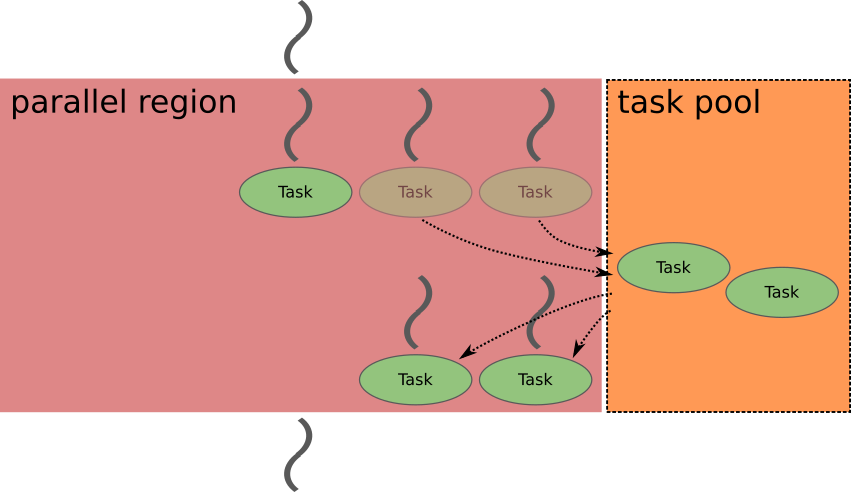
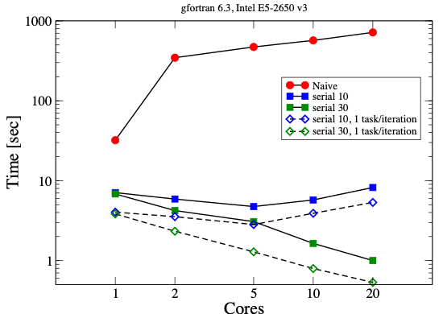
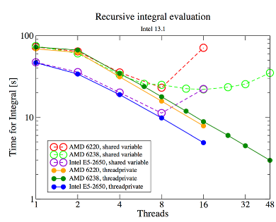

The Task Directive
==================

.. objectives::

 - Learn the basic terminology.
 - Learn about the :code:`task` construct.
 - Learn more about data sharing rules.
 - Learn how to construct a task graph in a three-based manner.
 - Learn how to construct a task graph in a centralised manner.
 - Learn how to wait tasks to complete their execution.

Beyond Regular Loops

Regular vs. Irregular Structures
--------------------------------

**Regular structures considered so far** include loops with known bounds and Fortran array constructs.

Many problems have **irregular structures**, including recursive algorithms, linked lists, loops with unknown bounds (such as ``while`` loops), and divide-and-conquer algorithms.

.. note::

   Depending on the details, irregular structures might still be parallelizable using tasks.

The Task Construct
------------------

The task construct provides a flexible way to express parallelism for irregular problems. A task creates a unit of work that can run immediately or later on the encountering thread or another thread in the team. An explicit task contains the structured block and its associated data environment.

The encountering thread can execute the task immediately or defer it. A task binds to the innermost parallel region; without an enclosing parallel region it executes in the initial team, without team-level parallelism.

**Task directive syntax**

.. tabs::

   .. tab:: C/C++

      .. code-block:: c

         #pragma omp task
         {
             /* code body */
         }

   .. tab:: Fortran

      .. code-block:: fortran

         !$omp task
             ! code body
         !$omp end task

Common task clauses include ``if``, ``final``, ``untied``, ``default``, ``mergeable``, ``private``, ``firstprivate``, ``shared``, ``in_reduction``, ``depend``, ``priority``, ``allocate`` and ``affinity``. ``detach`` is supported for C/C++ tasks but not Fortran tasks. Clause availability depends on the OpenMP version.

The familiar ``if``, ``private``, ``firstprivate``, and ``shared`` clauses can have task-specific data-sharing behavior.

**Hello world: one task created by each thread**

.. tabs::

   .. tab:: C/C++

      .. code-block:: c

         #include <stdio.h>
         int main() {
             #pragma omp parallel
             {
                 #pragma omp task
                 printf("Hello world!\n");
             }
             return 0;
         }

   .. tab:: Fortran

      .. code-block:: fortran

         program hello_tasks
             use omp_lib
             implicit none
             !$omp parallel
                 !$omp task
                     print *, "Hello world!"
                 !$omp end task
             !$omp end parallel
         end program hello_tasks

In this example, **each thread encounters the task construct**, producing one explicit task per thread. Any thread in the team can execute any of those tasks. Thus, with *N* threads, exactly *N* tasks are created.

The order in which the lines are printed is unspecified. For example, compiling C with ``gcc -fopenmp -o my_program my_program.c`` and running the program may print several ``Hello world!`` lines.

Allowed Data Sharing Attributes for Tasks
-----------------------------------------

- ``private``: a task-local copy, without initialization from the original value.
- ``firstprivate``: a task-local copy initialized when the task is encountered.
- ``shared``: tasks refer to the same variable; useful when tasks write results for later consumption.
- ``default``: controls implicit data-sharing attributes.

**Language-specific default-clause syntax (illustrative)**

.. tabs::

   .. tab:: C/C++

      .. code-block:: c

         #pragma omp task default(shared)
         { /* work */ }
         /* or: default(none), with explicit scoping */

   .. tab:: Fortran

      .. code-block:: fortran

         !$omp task default(shared)
             ! work
         !$omp end task
         ! Alternatively: default(private), default(firstprivate) or default(none)

Data Sharing Without a default Clause
-------------------------------------

If a variable is shared by all implicit tasks in the current team, the variable is generally ``shared`` in an explicit task. Otherwise, it generally becomes ``firstprivate``. Variables declared within the task body are local to that task.

.. important::

   Use ``default(none)`` and explicit data-sharing clauses when teaching or auditing task code; consider predetermined attributes as well.

**Example: task execution flow**

.. tabs::

   .. tab:: C/C++

      .. code-block:: c

         /* code block 1 */
         #pragma omp task
         {
             /* code block 2 */
         }
         /* code block 3 */

   .. tab:: Fortran

      .. code-block:: fortran

         ! code block 1
         !$omp task
             ! code block 2
         !$omp end task
         ! code block 3

The encountering thread performs block 1, generates a task for block 2, and eventually executes block 3. It may execute or defer block 2; neither the executing thread nor the completion time of block 2 is generally fixed.

.. dropdown:: Challenge: Hello World
   :color: warning

    Use two tasks where each prints out *Hello* and *World* strings. Use 4 threads.

.. solution::

    .. code-block:: c
        :linenos:

        // On cluster Kebnekaise
        // ml foss
        // export OMP_NUM_THREADS=1
        // gcc -O3 -march=native -fopenmp -o test.x 12a-task-openmp.c -lm
        #include <stdio.h>
        #include <omp.h>
        int main() {
            #pragma omp parallel num_threads(4)
            {
                #pragma omp task
                {printf("Hello\n");}
                #pragma omp task
                {printf("World\n");}
            }
            return 0;
        }

**Example: shared variable declared outside the parallel region**

The following deliberately shows unsynchronized increments to teach how task data-sharing attributes work. Its results are not deterministic; do not use it as a race-free increment pattern.

.. tabs::

   .. tab:: C/C++

      .. code-block:: c

         #include <stdio.h>
         int main() {
             int number = 1;
             #pragma omp parallel
             {
                 #pragma omp task
                 {
                     printf("I think the number is %d.\n", number);
                     number++;
                 }
             }
             return 0;
         }

   .. tab:: Fortran

      .. code-block:: fortran

         program shared_number
             use omp_lib
             implicit none
             integer :: number
             number = 1
             !$omp parallel shared(number)
                 !$omp task shared(number)
                     print *, "I think the number is", number
                     number = number + 1
                 !$omp end task
             !$omp end parallel
         end program shared_number

The original variable belongs to the enclosing shared data environment, so tasks may see each other's writes. Without synchronization, increments race and some updates may be lost.

**Example: variable local to the parallel region**

.. tabs::

   .. tab:: C/C++

      .. code-block:: c

         #include <stdio.h>
         int main() {
             #pragma omp parallel
             {
                 int number = 1;
                 #pragma omp task
                 {
                     printf("I think the number is %d.\n", number);
                     number++;
                 }
             }
             return 0;
         }

   .. tab:: Fortran

      .. code-block:: fortran

         program firstprivate_number
             use omp_lib
             implicit none
             !$omp parallel
                 block
                     integer :: number
                     number = 1
                     !$omp task firstprivate(number)
                         print *, "I think the number is", number
                         number = number + 1
                     !$omp end task
                 end block
             !$omp end parallel
         end program firstprivate_number

Here each generated task starts with its own copy of ``number``. With ``firstprivate`` the value is captured at task creation; all tasks print the initial value 1 (the order of output may vary).

.. dropdown:: Challenge: Types of variables
   :color: warning

    Replace the *fixme* strings with the types of the variables in the code when the defaults are used.
    (Exercise inspired in an example of `Christian Terboven <https://hpc-wiki.info/hpc/OpenMP_in_Small_Bites>`_).

    .. code-block:: c
        :linenos:

        #include <stdio.h>
        #include <omp.h>
        static int first = 1;  // File scope (static global)
        int main() {
            // Variables in main scope
            int second = 2;
            int third = 3;
            #pragma omp parallel private(second)
            {
                // Variable in parallel region scope
                int fourth = 4;
                #pragma omp task
                {
                    // Variable in task scope
                    int fifth = 5;
                    // Data scoping in this task:
                    // "first":  *fixme*    (static global)
                    // "second": *fixme*    (private in parallel, becomes firstprivate in task)
                    // "third":  *fixme*    (declared outside parallel)
                    // "fourth": *fixme*    (declared in parallel region)
                    // "fifth":  *fixme*    (declared in task)
                    printf("1=%d, 2=%d, 3=%d, 4=%d, 5=%d\n",
                        first, second, third, fourth, fifth);
                }
            }
            return 0;
        }

    Now, use default(none) and write the types of the variables in the *fixme* strings to have the
    same behavior as in the previous code:

    .. code-block:: c
        :linenos:

        #pragma omp parallel private(*fixme*) default(none) shared(*fixme*, *fixme*)
        {
            int fourth = 4;
            #pragma omp task default(none) firstprivate(*fixme*,*fixme*) shared(*fixme*, *fixme*)
            {
                int fifth = 5;
                printf("1=%d, 2=%d, 3=%d, 4=%d, 5=%d\n",
                    first, second, third, fourth, fifth);
            }
        }

.. solution::

    The variables using default data scope look like:

    .. code-block:: c
        :linenos:

        #include <stdio.h>
        #include <omp.h>
        static int first = 1;  // File scope (static global)
        int main() {
            // Variables in main scope
            int second = 2;
            int third = 3;
            #pragma omp parallel private(second)
            {
                // Variable in parallel region scope
                int fourth = 4;
                #pragma omp task
                {
                    // Variable in task scope
                    int fifth = 5;
                    // Data scoping in this task:
                    // "first":  shared        (static global)
                    // "second": firstprivate  (private in parallel, becomes firstprivate in task)
                    // "third":  shared        (declared outside parallel)
                    // "fourth": firstprivate  (declared in parallel region)
                    // "fifth":  private       (declared in task)
                    printf("1=%d, 2=%d, 3=%d, 4=%d, 5=%d\n",
                        first, second, third, fourth, fifth);
                }
            }
            return 0;
        }

    And not using defaults **default(none)**, the variables will need to be declared as follows to have
    the same behavior as in the previous code:

    .. code-block:: c
        :linenos:

        #pragma omp parallel private(second) default(none) shared(first, third)
        {
            int fourth = 4;
            #pragma omp task default(none) firstprivate(second, fourth) shared(first, third)
            {
                int fifth = 5;
                printf("1=%d, 2=%d, 3=%d, 4=%d, 5=%d\n",
                    first, second, third, fourth, fifth);
            }
        }

Single Construct
----------------

In the previous examples every team thread created a task. Often, however, **only one thread should generate the task graph**. Use ``single`` inside ``parallel`` to arrange that. Any thread may execute the generated tasks.

.. tabs::

   .. tab:: C/C++

      .. code-block:: c

         #include <stdio.h>
         int main() {
             #pragma omp parallel
             #pragma omp single nowait
             {
                 #pragma omp task
                 printf("Hello world!\n");
             }
             return 0;
         }

   .. tab:: Fortran

      .. code-block:: fortran

         program single_task
             implicit none
             !$omp parallel
                 !$omp single
                     !$omp task
                         print *, "Hello world!"
                     !$omp end task
                 !$omp end single nowait
             !$omp end parallel
         end program single_task

The ``nowait`` clause removes the implicit barrier at the end of ``single``; the end of the parallel region still waits for outstanding tasks. This creates only one ``Hello world!`` task.

.. challenge::

    Write a program that creates 10 tasks.
    Each task should print the thread number of the calling thread.
    **Hint:** From the :code:`omp.h` header file:

    .. code-block:: c

        int omp_get_thread_num (void);

.. solution::

    .. code-block:: c
        :linenos:

        #include <stdio.h>
        #include <omp.h>
        int main() {
            #pragma omp parallel
            #pragma omp single nowait
            {
                for (int i = 0; i < 10; i++) {
                    #pragma omp task
                    printf("I am thread no. %d.\n", omp_get_thread_num());
                }
            }
            return 0;
        }

    .. code-block:: bash
        :emphasize-lines: 3-12

        $ gcc -o my_program my_program.c -Wall -fopenmp
        $ ./my_program
        I am thread no. 5.
        I am thread no. 13.
        I am thread no. 6.
        I am thread no. 8.
        I am thread no. 4.
        I am thread no. 7.
        I am thread no. 15.
        I am thread no. 12.
        I am thread no. 0.
        I am thread no. 9.

.. dropdown:: Challenge: Behavior of variables
   :color: warning

    Inspect and run the following code to see the behavior of shared, private, and first private variables in the context of tasks.
    Notice that one can use **atomic updates** together with tasks.

    .. code-block:: c
        :linenos:

        // On cluster Kebnekaise
        // ml foss
        // export OMP_NUM_THREADS=1
        // gcc -O3 -march=native -fopenmp -o test.x 13a-sharedprivate-task-openmp.c -lm
        #include <stdio.h>
        #include <omp.h>
        void process_task(int id, int *shared_data) {
            printf("Task %d: shared_data = %d\n", id, *shared_data);
        }
        int main() {
            int shared_data = 100; // variable that is shared across tasks
            int private_data = 200; // variable is private to each task
            #pragma omp parallel
            {
                #pragma omp single
                {
                    for (int i = 0; i < 4; i++) {
                        int firstprivate_data = i * 10; // firstprivate variable: unique for each task but initialized with i * 10
                        #pragma omp task shared(shared_data) private(private_data) firstprivate(firstprivate_data, i)
                        {
                            // here we modify the private_data variable, which is unique to each task
                            private_data = i * 100;
                            printf("Task %d: private_data = %d, firstprivate_data = %d\n", i, private_data, firstprivate_data);
                            // Calling a function with shared data
                            process_task(i, &shared_data);
                            // Use an atomic op. for shared_data  or critical?
                            #pragma omp atomic
                            shared_data += 1;
                        }
                    }
                }
            }
            printf("Final value of shared_data: %d\n", shared_data);
            return 0;
        }

.. dropdown:: Challenge: Behavior of variables in tasks
   :color: warning

    Inspect and run the following code to see the behavior of first private variables in the context of tasks.

    .. code-block:: c
        :linenos:

        // On cluster Kebnekaise
        // ml foss
        // export OMP_NUM_THREADS=1
        // gcc -O3 -march=native -fopenmp -o test.x 13b-firstprivate-task-openmp.c -lm
        #include <stdio.h>
        #include <omp.h>
        void task_example() {
            int n = 5; // a shared variable with an initial value
            #pragma omp parallel
            {
                #pragma omp single
                {
                    for (int i = 0; i < 5; i++) {
                        #pragma omp task firstprivate(n)
                        {
                            // n is private to each task, initialized with its value at task creation
                            n += i; // Modify n for this task
                            printf("Task %d: n = %d\n", i, n);
                        }
                    }
                }
            }
        }
        int main() {
            task_example();
            return 0;
        }

.. challenge::

    The following function takes an integer as input, and writes the thread number that handles
    the execution of the function. Use ``tasks`` to parallelize a *for* loop where each task
    executes this function:

    .. code-block:: c
        :linenos:

        void process_element(int i) {
            // do some work for each element by printing out the thread ID excuting this work
            printf("Processing element %d in thread %d\n", i, omp_get_thread_num());
        }

.. solution::

    .. code-block:: c
        :linenos:

        // On cluster Kebnekaise
        // ml foss
        // export OMP_NUM_THREADS=1
        // gcc -O3 -march=native -fopenmp -o test.x 12c-task-openmp.c -lm
        #include <stdio.h>
        #include <omp.h>
        void process_element(int i) {
            // do some work for each element by printing out the thread ID excuting this work
            printf("Processing element %d in thread %d\n", i, omp_get_thread_num());
        }
        int main() {
            int n = 10;
            #pragma omp parallel
            {
                // single directive ensures that only one thread generates tasks
                #pragma omp single
                {
                    for (int i = 0; i < n; i++) {
                        // Create a new task for each array element
                        #pragma omp task
                        {
                        process_element(i);
                        }
                    }
                printf("Generating tasks \n");
                }
            }
            return 0;
        }

Allowing Suspension of the Current Task
---------------------------------------

A ``taskyield`` is a task scheduling point at which the runtime *may* suspend the current task and allow another task to run. It is a hint, not a guarantee that another task is scheduled.

**taskyield directive**

.. tabs::

   .. tab:: C/C++

      .. code-block:: c

         #pragma omp taskyield

   .. tab:: Fortran

      .. code-block:: fortran

         !$omp taskyield

This can be useful when a task waits for resources, although it must not be relied on to provide progress or to fix incorrect locking.

.. dropdown:: Challenge: taskyield behavior
   :color: warning

    Inspect and run the following code to see the behavior of *taskyield* in the context of tasks.

    .. code-block:: c
        :linenos:

        // On cluster Kebnekaise
        // ml foss
        // export OMP_NUM_THREADS=1
        // gcc -O3 -march=native -fopenmp -o test.x 17-taskyield-openmp.c -lm
        // ml GCCcore/12.3.0 Clang/16.0.6
        // clang -O3 -fopenmp -o test.x 17-taskyield-openmp.c
        #include <omp.h>
        #include <stdio.h>
        #include <unistd.h>
        #include <stdlib.h>
        void something_useful(int id,int random_time) {
            sleep(random_time); // Simulate work
            printf("Task %d: did something useful on thread %d\n", id, omp_get_thread_num());
        }
        void something_critical(int id,int random_time) {
            sleep(random_time); // Simulate longer work
            printf("Task %d: did something critical on thread %d\n", id, omp_get_thread_num());
        }
        void foo(omp_lock_t *lock, int n) {
            srand(1999); // seed the random number generator
            int min = 1, max = 10;
            for (int i = 0; i < n; i++) {
                int random_time1 = rand() % (max - min + 1) + min;
                int random_time2 = rand() % (max - min + 1) + min;
                #pragma omp task
                {
                    something_useful(i,random_time1);
                    // Use taskyield to allow other tasks to execute while waiting
                    while (!omp_test_lock(lock)) {
                        #pragma omp taskyield
                        sleep(5);
                    }
                    something_critical(i,random_time2);
                    omp_unset_lock(lock);
                }
            }
        }
        int main() {
            int n = 10; // Number of tasks
            omp_lock_t lock;
            omp_init_lock(&lock);
            #pragma omp parallel
            {
                #pragma omp single
                foo(&lock, n);
            }
            omp_destroy_lock(&lock);
            return 0;
        }

    Child tasks and taskwait construct
    A task can create new **child tasks**:

Child Tasks and the taskwait Construct
--------------------------------------

A task can create **child tasks**. A child may run even after the generating parent task finishes its own structured block. ``taskwait`` without clauses waits for the generating task's direct children; it does not generally wait for all descendants.

**Child tasks without an explicit taskwait**

.. tabs::

   .. tab:: C/C++

      .. code-block:: c

         #include <stdio.h>
         int main() {
             #pragma omp parallel
             #pragma omp single
             {
                 #pragma omp task
                 {
                     #pragma omp task
                     printf("Hello.\n");
                     printf("Hi.\n");
                 }
                 printf("Hej.\n");
             }
             printf("Goodbye.\n");
             return 0;
         }

   .. tab:: Fortran

      .. code-block:: fortran

         program child_tasks
             implicit none
             !$omp parallel
                 !$omp single
                     !$omp task
                         !$omp task
                             print *, "Hello."
                         !$omp end task
                         print *, "Hi."
                     !$omp end task
                     print *, "Hej."
                 !$omp end single
             !$omp end parallel
             print *, "Goodbye."
         end program child_tasks

The output ordering may vary: in particular, ``Hello.`` can appear before or after ``Hi.``. ``Goodbye.`` is printed after completion of the parallel region.

**Adding taskwait**

.. tabs::

   .. tab:: C/C++

      .. code-block:: c

         #include <stdio.h>
         int main() {
             #pragma omp parallel
             #pragma omp single
             {
                 #pragma omp task
                 {
                     #pragma omp task
                     printf("Hello.\n");
                     #pragma omp taskwait
                     printf("Hi.\n");
                 }
                 printf("Hej.\n");
             }
             printf("Goodbye.\n");
             return 0;
         }

   .. tab:: Fortran

      .. code-block:: fortran

         program waiting_for_children
             implicit none
             !$omp parallel
                 !$omp single
                     !$omp task
                         !$omp task
                             print *, "Hello."
                         !$omp end task
                         !$omp taskwait
                         print *, "Hi."
                     !$omp end task
                     print *, "Hej."
                 !$omp end single
             !$omp end parallel
             print *, "Goodbye."
         end program waiting_for_children

In this version ``Hello.`` precedes ``Hi.``; ``Hej.`` may appear before or after them, and ``Goodbye.`` is printed last.

Controlling When Tasks Finish
-----------------------------

A ``taskwait`` waits for direct child tasks. A ``barrier`` requires all participating team threads to arrive, and all explicit tasks bound to the parallel region to complete before the threads pass that barrier. While waiting, a thread may execute other available tasks.

**taskwait and barrier syntax**

.. tabs::

   .. tab:: C/C++

      .. code-block:: c

         #pragma omp taskwait
         /* ... */
         #pragma omp barrier

   .. tab:: Fortran

      .. code-block:: fortran

         !$omp taskwait
         ! ...
         !$omp barrier

**Tasks separated by a barrier**

.. tabs::

   .. tab:: C/C++

      .. code-block:: c

         #include <stdio.h>
         int main() {
             #pragma omp parallel
             {
                 #pragma omp task
                 printf("Hello.\n");
                 #pragma omp barrier
                 #pragma omp task
                 printf("Goodbye.\n");
             }
             return 0;
         }

   .. tab:: Fortran

      .. code-block:: fortran

         program barrier_tasks
             implicit none
             !$omp parallel
                 !$omp task
                     print *, "Hello."
                 !$omp end task
                 !$omp barrier
                 !$omp task
                     print *, "Goodbye."
                 !$omp end task
             !$omp end parallel
         end program barrier_tasks

Every task printing ``Hello.`` must complete before any thread passes the barrier to generate a ``Goodbye.`` task.

.. dropdown:: Challenge: taskwait and barrier
   :color: warning

    Inspect and run the following code to see the behavior of *taskwait* and *barrier* in the context of tasks.

    .. code-block:: c
        :linenos:

        // On cluster Kebnekaise
        // ml foss
        // export OMP_NUM_THREADS=1
        // gcc -O3 -march=native -fopenmp -o test.x 19-taskwait-barrier-openmp.c -lm
        // ml GCCcore/12.3.0 Clang/16.0.6
        // clang -O3 -fopenmp -o test.x 19-taskwait-barrier-openmp.c
        #include <stdio.h>
        #include <omp.h>
        #include <unistd.h>
        void process_task(int task_id) {
            printf("task %d started by thread %d\n", task_id, omp_get_thread_num());
            #pragma omp taskyield
            // do some work
            sleep(3);
            printf("task %d completed by thread %d\n", task_id, omp_get_thread_num());
        }
        int main() {
            #pragma omp parallel
            {
                #pragma omp single
                {
                    // create some initial tasks set of tasks
                    for (int i = 0; i < 3; i++) {
                        #pragma omp task
                        process_task(i);
                    }
                    // wait for all tasks created up to now
                    #pragma omp taskwait
                    printf("All tasks at this level completed, but children,grandchildren tasks may still be running.\n");
                    // Second set of tasks
                    for (int i = 3; i < 6; i++) {
                        #pragma omp task
                        process_task(i);
                    }
                }
                // A Barrier synchronizes all threads in the parallel region
                #pragma omp barrier
                printf("All threads have reached the barrier.\n");
            }
            return 0;
        }

    taskgroup: Controlling Descendant Tasks (OpenMP 4.0)
    A ``taskgroup`` construct defines a region with an implied task scheduling point at the end.
    Current task is suspended until **all descendant tasks** (including grandchildren, etc.) have completed.

taskgroup: Controlling Descendant Tasks (OpenMP 4.0)
----------------------------------------------------

A ``taskgroup`` waits for child tasks generated in its lexical region **and their descendants**, including grandchildren. This provides a more comprehensive wait than an ordinary ``taskwait``.

.. tabs::

   .. tab:: C/C++

      .. code-block:: c

         #pragma omp taskgroup
         {
             for (int i = 0; i < n; i++) {
                 #pragma omp task firstprivate(i)
                 processing(i);  /* may generate more tasks */
             }
         }  /* waits for descendants */

   .. tab:: Fortran

      .. code-block:: fortran

         !$omp taskgroup
         do i = 1, n
             !$omp task firstprivate(i)
                 call processing(i)  ! may generate more tasks
             !$omp end task
         end do
         !$omp end taskgroup  ! waits for descendants

Controlling Task Creation
-------------------------

Task generation has overhead. If the work per task is too small, execution can become slower than the serial version.

With the ``if`` clause on a task construct, a false condition generates an **undeferred task** which is executed immediately by the encountering thread rather than deferred for later execution. This is useful for controlling task granularity.

**if clause**

.. tabs::

   .. tab:: C/C++

      .. code-block:: c

         #pragma omp task if(level < 10)
         {
             process(level);
         }

   .. tab:: Fortran

      .. code-block:: fortran

         !$omp task if(level < 10)
             call process(level)
         !$omp end task

.. dropdown:: Challenge: if clause
   :color: warning

    Inspect and run the following code to see the behavior of *if* clause in the context of tasks.

    .. code-block:: c
        :linenos:

        // On cluster Kebnekaise
        // ml foss
        // export OMP_NUM_THREADS=1
        // gcc -O3 -march=native -fopenmp -o test.x 15-ifclause-task-openmp.c -lm
        #include <stdio.h>
        #include <omp.h>
        void process_task(int task_id) {
            printf("Processing iteration task %d in thread %d\n", task_id, omp_get_thread_num());
        }
        int main() {
            int n = 5; // Threshold for deciding if the task is executed synchronously or asynchrously
            #pragma omp parallel
            {
                #pragma omp single
                {
                    for (int i = 0; i < 10; i++) {
                        // the task creation will depend on the value of "i" and the clause with "if" condition
                        #pragma omp task if(i > n) // Tasks with i > n are deferred; others run in the current thread
                        {
                        process_task(i);
                        // childrens behave as regular tasks (can be deferred)
                        #pragma omp task
                        {
                            printf("Nested task for %d in thread %d\n", i, omp_get_thread_num());
                        }
                        }
                    }
                }
            }
            return 0;
        }

    Final Tasks
    A task can carry a ``final`` clause to control task generation in descendants.
    *Syntax*

Final Tasks
-----------

The ``final`` clause marks the generated task as final if its expression is true. Child tasks encountered within a final task are themselves final and **included**. This reduces task creation overhead in deep recursion; it does *not* prevent the task's own code from recursively executing.

**final clause**

.. tabs::

   .. tab:: C/C++

      .. code-block:: c

         #pragma omp task final(level > 30)
         {
             process(level);
         }

   .. tab:: Fortran

      .. code-block:: fortran

         !$omp task final(level > 30)
             call process(level)
         !$omp end task

.. dropdown:: Challenge: final clause
   :color: warning

    Inspect and run the following code to see the behavior of *final* clause in the context of tasks.

    .. code-block:: c
        :linenos:

        // On cluster Kebnekaise
        // ml foss
        // export OMP_NUM_THREADS=1
        // gcc -O3 -march=native -fopenmp -o test.x 16-finalclause-task-openmp.c -lm
        #include <stdio.h>
        #include <omp.h>
        void process_task(int task_id) {
            printf("Processing iteration task %d in thread %d\n", task_id, omp_get_thread_num());
        }
        int main() {
            int n = 5; // Threshold for the final clause
            #pragma omp parallel
            {
                #pragma omp single
                {
                    for (int i = 0; i < 10; i++) {
                        // when i <= n, the task and its child tasks are final and included
                        // when i > n, task is final and child tasks are regular tasks
                        #pragma omp task final(i <= n)
                        {
                            process_task(i);
                            #pragma omp task
                            {
                                printf("Nested task for %d in thread %d\n", i, omp_get_thread_num());
                                #pragma omp task
                                {
                                printf("Subnested task for %d in thread %d\n", i, omp_get_thread_num());
                                }
                            }
                        }
                    }
                }
            }
            return 0;
        }

    Mergeable Tasks
    A task can be declared as ``mergeable`` for optimization.
    *Syntax*

Mergeable Tasks
---------------

A task may be declared ``mergeable``. If it is undeferred or included, the implementation may reuse the generating task's data environment as an optimization; this is optional and code must not depend on whether the optimization occurs.

**mergeable clause**

.. tabs::

   .. tab:: C/C++

      .. code-block:: c

         #pragma omp task mergeable
         {
             process();
         }

   .. tab:: Fortran

      .. code-block:: fortran

         !$omp task mergeable
             call process()
         !$omp end task

.. dropdown:: Challenge: mergeable clause
   :color: warning

    Inspect and run the following code to see the behavior of *mergeable* clause in the context of tasks.

    .. code-block:: c
        :linenos:

        // On cluster Kebnekaise
        // ml foss
        // export OMP_NUM_THREADS=1
        // gcc -O3 -march=native -fopenmp -o test.x 18b-mergeable-task-openmp.c -lm
        // ml GCCcore/12.3.0 Clang/16.0.6
        // clang -O3 -fopenmp -o test.x 18b-mergeable-task-openmp.c
        #include <omp.h>
        #include <stdio.h>
        void process_task(int task_id) {
            printf("Processing task %d on thread %d\n", task_id, omp_get_thread_num());
        }
        int main() {
            int n = 10; // nr. of iterations
            #pragma omp parallel
            {
                #pragma omp single
                {
                    for (int i = 0; i < n; i++) {
                        // tasks with the mergeable clause
                        #pragma omp task mergeable
                        {
                            process_task(i);
                        }
                    }
                }
            }
            return 0;
        }

Task Scheduling Points
----------------------

The runtime may switch tasks at scheduling points, including immediately after task creation, task completion, ``taskwait``/``taskyield``, explicit or implicit barriers, and at the end of a ``taskgroup``.

.. warning::

   Untied tasks can resume on a different thread at task scheduling points. Be especially careful with locks and thread-local state; incorrect use can deadlock.

Case Study 1: Recursive Fibonacci
---------------------------------

Fibonacci numbers satisfy the recurrence:

.. math::

   F_0 = 0, \qquad F_1 = 1, \qquad F_n = F_{n-1} + F_{n-2}

The sequence starts ``0, 1, 1, 2, 3, 5, 8, 13, 21, 34, ...``. Recursive Fibonacci is inefficient as a real numerical algorithm, but useful for demonstrating OpenMP tasks.

**Recursion tree**

.. code-block:: text

   n
   |-- n-1
   |   |-- n-2
   |   `-- n-3
   `-- n-2
       |-- n-3
       `-- n-4

**Serial Fibonacci implementation**

.. tabs::

   .. tab:: C/C++

      .. code-block:: c

         unsigned long long recursive_fib(int in) {
             unsigned long long fibnum, sub1, sub2;
             if (in > 1) {
                 sub1 = recursive_fib(in - 1);
                 sub2 = recursive_fib(in - 2);
                 fibnum = sub1 + sub2;
             } else {
                 fibnum = in;
             }
             return fibnum;
         }

   .. tab:: Fortran

      .. code-block:: fortran

         recursive function recursive_fib(in) result(fibnum)
             integer, intent(in) :: in
             integer(lint) :: fibnum, sub1, sub2
             if (in .gt. 1) then
                 sub1 = recursive_fib(in - 1)
                 sub2 = recursive_fib(in - 2)
                 fibnum = sub1 + sub2
             else
                 fibnum = in
             endif
         end function recursive_fib

**Parallel attempt 1: create one task**

.. tabs::

   .. tab:: C/C++

      .. code-block:: c

         unsigned long long recursive_fib(int in) {
             unsigned long long fibnum, sub1, sub2;
             if (in > 1) {
                 #pragma omp task shared(sub1) firstprivate(in)
                 {
                     sub1 = recursive_fib(in - 1);
                 }
                 sub2 = recursive_fib(in - 2);
                 fibnum = sub1 + sub2;
             } else {
                 fibnum = in;
             }
             return fibnum;
         }

   .. tab:: Fortran

      .. code-block:: fortran

         recursive function recursive_fib(in) result(fibnum)
             integer, intent(in) :: in
             integer(lint) :: fibnum, sub1, sub2
             if (in .gt. 1) then
                 !$OMP task shared(sub1) firstprivate(in)
                     sub1 = recursive_fib(in - 1)
                 !$OMP end task
                 sub2 = recursive_fib(in - 2)
                 fibnum = sub1 + sub2
             else
                 fibnum = in
             endif
         end function recursive_fib

Here ``sub1`` must be shared to return the computed result, while ``in`` is copied at task creation. The attempt is missing a wait before reading ``sub1``.

**Parallel attempt 2: create two tasks (incorrect)**

.. tabs::

   .. tab:: C/C++

      .. code-block:: c

         unsigned long long recursive_fib(int in) {
             unsigned long long fibnum, sub1, sub2;
             if (in > 1) {
                 #pragma omp task shared(sub1) firstprivate(in)
                 {
                     sub1 = recursive_fib(in - 1);
                 }
                 #pragma omp task shared(sub2) firstprivate(in)
                 {
                     sub2 = recursive_fib(in - 2);
                 }
                 fibnum = sub1 + sub2;
             } else {
                 fibnum = in;
             }
             return fibnum;
         }

   .. tab:: Fortran

      .. code-block:: fortran

         recursive function recursive_fib(in) result(fibnum)
             integer, intent(in) :: in
             integer(lint) :: fibnum, sub1, sub2
             if (in .gt. 1) then
                 !$OMP task shared(sub1) firstprivate(in)
                     sub1 = recursive_fib(in - 1)
                 !$OMP end task
                 !$OMP task shared(sub2) firstprivate(in)
                     sub2 = recursive_fib(in - 2)
                 !$OMP end task
                 fibnum = sub1 + sub2
             else
                 fibnum = in
             endif
         end function recursive_fib

.. danger::

   This attempt uses ``sub1`` and ``sub2`` before the child tasks are guaranteed to finish. It is intentionally incorrect.

**Parallel final solution: taskwait**

.. tabs::

   .. tab:: C/C++

      .. code-block:: c

         unsigned long long recursive_fib(int in) {
             unsigned long long fibnum, sub1, sub2;
             if (in > 1) {
                 #pragma omp task shared(sub1) firstprivate(in)
                 {
                     sub1 = recursive_fib(in - 1);
                 }
                 #pragma omp task shared(sub2) firstprivate(in)
                 {
                     sub2 = recursive_fib(in - 2);
                 }
                 #pragma omp taskwait
                 fibnum = sub1 + sub2;
             } else {
                 fibnum = in;
             }
             return fibnum;
         }

   .. tab:: Fortran

      .. code-block:: fortran

         recursive function recursive_fib(in) result(fibnum)
             integer, intent(in) :: in
             integer(lint) :: fibnum, sub1, sub2
             if (in .gt. 1) then
                 !$OMP task shared(sub1) firstprivate(in)
                     sub1 = recursive_fib(in - 1)
                 !$OMP end task
                 !$OMP task shared(sub2) firstprivate(in)
                     sub2 = recursive_fib(in - 2)
                 !$OMP end task
                 !$OMP taskwait
                 fibnum = sub1 + sub2
             else
                 fibnum = in
             endif
         end function recursive_fib

``taskwait`` waits for the two children at each recursive call. Each child call manages its own descendants.

**Calling Fibonacci from serial code**

.. tabs::

   .. tab:: C/C++

      .. code-block:: c

         #include <stdio.h>
         #include <stdlib.h>
         int main(int argc, char *argv[]) {
             unsigned long long fibres;
             int input;
             printf("Enter input: ");
             scanf("%d", &input);
             fibres = recursive_fib(input);
             printf("Fibonacci number %d is: %llu\n", input, fibres);
             return 0;
         }

   .. tab:: Fortran

      .. code-block:: fortran

         program fibonacci
             !$ use omp_lib
             integer, parameter :: lint = selected_int_kind(10)
             integer(lint) :: fibres
             integer :: input
             read (*,*) input
             fibres = recursive_fib(input)
             print *, "Fibonacci number", input, " is:", fibres
         end program fibonacci

**Incorrect: starting a parallel region without single**

.. tabs::

   .. tab:: C/C++

      .. code-block:: c

         #include <stdio.h>
         #include <stdlib.h>
         #include <omp.h>
         int main(int argc, char *argv[]) {
             unsigned long long fibres;
             int input;
             printf("Enter input: ");
             scanf("%d", &input);
             #pragma omp parallel shared(input, fibres) default(none)
             {
                 fibres = recursive_fib(input);
             }
             printf("Fibonacci number %d is: %llu\n", input, fibres);
             return 0;
         }

   .. tab:: Fortran

      .. code-block:: fortran

         program fibonacci
             !$ use omp_lib
             integer, parameter :: lint = selected_int_kind(10)
             integer(lint) :: fibres
             integer :: input
             read (*,*) input
             !$OMP parallel shared(input, fibres) default(none)
                 fibres = recursive_fib(input)
             !$OMP end parallel
             print *, "Fibonacci number", input, " is:", fibres
         end program fibonacci

.. danger::

   Every thread redundantly starts the entire Fibonacci calculation.

**Correct: one thread starts Fibonacci using single**

.. tabs::

   .. tab:: C/C++

      .. code-block:: c

         #include <stdio.h>
         #include <stdlib.h>
         #include <omp.h>
         int main(int argc, char *argv[]) {
             unsigned long long fibres;
             int input;
             printf("Enter input: ");
             scanf("%d", &input);
             #pragma omp parallel shared(input, fibres) default(none)
             {
                 #pragma omp single
                 {
                     fibres = recursive_fib(input);
                 }
             }
             printf("Fibonacci number %d is: %llu\n", input, fibres);
             return 0;
         }

   .. tab:: Fortran

      .. code-block:: fortran

         program fibonacci
             !$ use omp_lib
             integer, parameter :: lint = selected_int_kind(10)
             integer(lint) :: fibres
             integer :: input
             read (*,*) input
             !$OMP parallel shared(input, fibres) default(none)
                 !$OMP single
                     fibres = recursive_fib(input)
                 !$OMP end single
             !$OMP end parallel
             print *, "Fibonacci number", input, " is:", fibres
         end program fibonacci

The ``single`` construct ensures that only one thread initiates the recursion while the full team can run tasks. The Fortran function fragments assume ``lint`` is defined in an appropriate enclosing module or scope, as in the original example.

Performance: Fibonacci Number 40
--------------------------------

**Task overhead:** Creating tasks has measurable cost, so recursive tasks should contain enough work. Common optimization strategies are to stop deferring tasks below a recursion threshold, limit the number of tasks, and balance parallelism against overhead.

**Using if to reduce task deferral**

.. tabs::

   .. tab:: C/C++

      .. code-block:: c

         #pragma omp task shared(sub1) firstprivate(in) if(in > 30)
         { sub1 = recursive_fib(in - 1); }
         #pragma omp task shared(sub2) firstprivate(in) if(in > 30)
         { sub2 = recursive_fib(in - 2); }
         #pragma omp taskwait

   .. tab:: Fortran

      .. code-block:: fortran

         !$omp task shared(sub1) firstprivate(in) if(in > 30)
             sub1 = recursive_fib(in - 1)
         !$omp end task
         !$omp task shared(sub2) firstprivate(in) if(in > 30)
             sub2 = recursive_fib(in - 2)
         !$omp end task
         !$omp taskwait

**Original benchmark:** Fibonacci(40) on Intel E5-2650 v3 hardware; gfortran 6.3 and ifort 17.1 with thread binding. The original material reports poor performance with two tiny tasks per call, improvement from conditional tasks, and further improvement with fewer tasks.

**Hardware:** Two sockets, 10 cores per Intel E5-2650 v3 processor. Benchmark results are historical and hardware/compiler-specific.

Case Study 2: Self-Refining Recursive Integrator
------------------------------------------------

Irregular numerical grids often benefit from dynamic mesh refinement, such as refining where a fluid-dynamics eddy develops and coarsening where it disappears.

**Adaptive integration algorithm:** Evaluate a function at five points in an interval, compare a five-point estimate against a coarser three-point estimate, and accept the interval if the error is sufficiently small. Otherwise, divide the interval into two subintervals and recurse using tasks.

**Start the recursive integrator once**

.. tabs::

   .. tab:: C/C++

      .. code-block:: c

         /* Illustrative fragment in an enclosing C function. */
         double accumulator = 0.0;
         #pragma omp parallel shared(accumulator, startv, stopv, unit_err, gen_num)
         {
             #pragma omp single
             rec_eval_shared_update(startv, stopv, unit_err, gen_num,
                                    &accumulator);
         }

   .. tab:: Fortran

      .. code-block:: fortran

         accumulator = 0.0D0
         !$OMP parallel default(none) &
         !$OMP shared(accumulator) &
         !$OMP shared(startv, stopv, unit_err, gen_num)
             !$OMP single
                 call rec_eval_shared_update( &
                     startv, stopv, unit_err, gen_num)
             !$OMP end single
         !$OMP end parallel

A shared accumulator stores the result. The ``single`` directive launches recursion only once; the parallel region completion waits for generated tasks. The C example is an added conceptual counterpart: its routine accepts a pointer to the accumulator rather than using a Fortran module variable. Inside the recursive C routine, the pointer is firstprivate in generated tasks, but the pointee is shared.

**Generate tasks for both half-intervals**

.. tabs::

   .. tab:: C/C++

      .. code-block:: c

         /* my_start, my_stop, u_err, my_gen and task_start
            are values visible in the surrounding function. */
         #pragma omp task firstprivate(accumulator, my_start, my_stop, u_err, my_gen) if(task_start)
         rec_eval_shared_update(my_start, 0.5 * (my_start + my_stop),
                                u_err, my_gen, accumulator);
         #pragma omp task firstprivate(accumulator, my_start, my_stop, u_err, my_gen) if(task_start)
         rec_eval_shared_update(0.5 * (my_start + my_stop), my_stop,
                                u_err, my_gen, accumulator);

   .. tab:: Fortran

      .. code-block:: fortran

         !$OMP task shared(accumulator) firstprivate(my_start, my_stop) &
         !$OMP default(none) firstprivate(my_gen, u_err) &
         !$OMP if(task_start)
             call rec_eval_shared_update( &
                 my_start, 0.5_dpr * (my_start + my_stop), u_err, my_gen)
         !$OMP end task
         !$OMP task shared(accumulator) firstprivate(my_start, my_stop) &
         !$OMP default(none) firstprivate(my_gen, u_err) &
         !$OMP if(task_start)
             call rec_eval_shared_update( &
                 0.5_dpr * (my_start + my_stop), my_stop, u_err, my_gen)
         !$OMP end task

Each task may recursively subdivide again. ``if(task_start)`` can limit deferred-task creation at deeper generations.

**Accumulating results:** A simple strategy uses atomic updates of a shared accumulator. Another option uses threadprivate accumulation, although threadprivate state belongs to a thread, not to an explicit task, so care is needed around task scheduling points. Newer OpenMP versions also support task reductions.

**Atomic accumulation**

.. tabs::

   .. tab:: C/C++

      .. code-block:: c

         #pragma omp atomic update
         *accumulator += contribution;

   .. tab:: Fortran

      .. code-block:: fortran

         !$omp atomic update
         accumulator = accumulator + contribution

.. warning::

   For threadprivate accumulation, ensure correctness across task scheduling and synchronization points. Threadprivate state must not be confused with task-private state.

**Test function**

.. math::

   f(x) = \sin^2(10000x) \cdot \sin^4(x)

The oscillatory function motivates localized refinement.

**Original performance setup:** Tasks started every fifth generation, comparing two accumulation strategies. The original measurements found high overhead for millions of atomic updates and better scaling for threadprivate accumulation, up to 128 cores.

.. note::

   In the original benchmark, GCC scaled less effectively than Intel's compiler beyond approximately 20 cores. These are historical performance observations.

Task Dependencies (OpenMP 4.0)
------------------------------

Task dependences express ordering constraints between sibling tasks. ``depend(in: ...)`` waits for earlier siblings writing matching storage, whereas ``depend(out: ...)`` and ``depend(inout: ...)`` also order writers against preceding readers and writers. Array sections may appear as list items.

**Dependency clause syntax**

.. tabs::

   .. tab:: C/C++

      .. code-block:: c

         #pragma omp task depend(in: a)
         use_value(a);

   .. tab:: Fortran

      .. code-block:: fortran

         !$omp task depend(in: a)
             call use_value(a)
         !$omp end task

**Task dependency example**

.. tabs::

   .. tab:: C/C++

      .. code-block:: c

         #pragma omp task depend(out: a)
         task_function_1(&a);
         #pragma omp task depend(in: a)
         task_function_2(a);
         #pragma omp task depend(in: a)
         task_function_3(a);

   .. tab:: Fortran

      .. code-block:: fortran

         !$omp task depend(out: a)
             call task_function_1(a)
         !$omp end task
         !$omp task depend(in: a)
             call task_function_2(a)
         !$omp end task
         !$omp task depend(in: a)
             call task_function_3(a)
         !$omp end task

First, the task writing ``a`` completes; afterward, the two tasks reading ``a`` may proceed in parallel. This permits more flexible scheduling than a whole-team barrier.

.. dropdown:: Challenge: behavior of dependencies
   :color: warning

    Inspect and run the following code to see the behavior of dependencies in the context of tasks.

    .. code-block:: c
        :linenos:

        // On cluster Kebnekaise
        // ml foss
        // export OMP_NUM_THREADS=1
        // gcc -O3 -march=native -fopenmp -o test.x 14-lifecycle-task-openmp.c -lm
        #include <stdio.h>
        #include <omp.h>
        int taskA(int *a) {
            *a += 1;
            printf("Executing taskA, a=%d\n",*a);
        }
        int taskB(int *a, int *b) {
            *a += 1;
            *b += 1;
            printf("Executing taskB, a=%d  b=%d\n", *a,*b);
        }
        int taskC(int *a, int *b, int *c) {
            *a += 1;
            *b += 1;
            *c += 1;
            printf("Executing taskC, a=%d  b=%d  c=%d\n",*a,*b,*c);
        }
        int main() {
            int a = 0;
            int b = 0;
            int c = 0;
            #pragma omp parallel
            {
                #pragma omp single
                {
                    #pragma omp task depend(out : a)
                    taskA(&a);  // taskA runs independently
                    #pragma omp task depend(in : a) depend(out : b)
                    taskB(&a,&b);  // taskB is suspended until taskA completes
                                // when dependencies are satisfied the task is resumed
                                // and is ready to continue
                    #pragma omp task depend(in : b)
                    taskC(&a,&b,&c);  // taskC is suspended until taskB completes
                }
            }
            return 0;
        }

.. dropdown:: Challenge: Fibonacci task dependencies
   :color: warning

    In the previous implementation of the Fibonacci generator code, we noticed that the values of
    Fibonacci numbers are computed several times during recursion. This situation can be avoided by using
    task dependencies, as in the following graph which shows the dependencies that we can create explicitl
    for the Fibonacci number 6:

    .. code-block:: text

        fib[6]
        depends on fib[5] and fib[4]
                |
                v
              fib[5]
                depends on fib[4] and fib[3]
                    |
                    v
                  fib[4]
                    depends on fib[3] and fib[2]
                    /                          \
                   v                            v
                fib[3]                        fib[2]
                depends on fib[2] and fib[1]   depends on fib[1] and fib[0]
                \|  \                               |          \
                v   v                              v           v
            fib[2] fib[1]                     fib[1]       fib[0]
            depends on fib[1] and fib[0]
            \|  \
            v   v
            fib[1] fib[0]
        Base values:
        fib[1] = 1
        fib[0] = 0

    Write a code for the Fibonacci numbers generator but now using task dependencies.
.. solution::

    .. code-block:: c
        :linenos:

        // On cluster Kebnekaise
        // ml foss
        // export OMP_NUM_THREADS=4
        // gcc -O3 -march=native -fopenmp -o test.x fibonacci_task_dependencies.c -lm
        #include <stdio.h>
        #include <stdlib.h>
        #include <omp.h>
        int main(int argc, char* argv[]) {
            int n = (argc > 1) ? atoi(argv[1]) : 40;
            unsigned long long *fib = malloc((n+1) * sizeof(unsigned long long));
            #pragma omp parallel
            {
                #pragma omp single
                {
                    // Base cases
                    #pragma omp task depend(out: fib[0])
                    { fib[0] = 0; }
                    #pragma omp task depend(out: fib[1])
                    { fib[1] = 1; }
                    // Create tasks for F(2) .. F(n)
                    for (int i = 2; i <= n; i++) {
                        #pragma omp task depend(in: fib[i-1], fib[i-2]) depend(out: fib[i])
                        {
                            fib[i] = fib[i-1] + fib[i-2];
                        }
                    }
                    // Wait until fib[n] is available
                    #pragma omp taskwait
                    printf("fib(%d) = %llu\n", n, fib[n]);
                }
            }
            free(fib);
            return 0;
        }

taskloop Construct (OpenMP 4.5)
-------------------------------

The ``taskloop`` construct partitions iterations into tasks rather than assigning iterations directly to threads as ``omp for`` or ``omp do`` does. Unless ``nogroup`` is present, it implies a ``taskgroup`` that waits for the generated loop tasks.

**Basic taskloop syntax**

.. tabs::

   .. tab:: C/C++

      .. code-block:: c

         #pragma omp taskloop shared(a) firstprivate(n)
         for (int i = 0; i < n; i++) {
             a[i] = expensive_function(i);
         }

   .. tab:: Fortran

      .. code-block:: fortran

         !$omp taskloop shared(a) firstprivate(n)
         do i = 1, n
             a(i) = expensive_function(i)
         end do
         !$omp end taskloop

Clauses for taskloop
~~~~~~~~~~~~~~~~~~~~

Clauses include ``if``, ``shared``, ``private``, ``firstprivate``, ``lastprivate``, ``default``, ``collapse``, ``final``, ``nogroup``, ``grainsize`` and ``num_tasks``. Modern OpenMP versions also support ``reduction`` on ``taskloop``; this was **not** supported by the original course's older OpenMP-version notes. ``in_reduction`` is also available in appropriate contexts.

There is also a ``taskloop simd`` construct for vectorization.

.. dropdown:: Challenge: taksloop
   :color: warning

    Inspect and run the following code to see the behavior of *taskloop* in the context of tasks.

    .. code-block:: c
        :linenos:

        // On cluster Kebnekaise
        // ml foss
        // export OMP_NUM_THREADS=1
        // gcc -O3 -march=native -fopenmp -o test.x 20a-taskloop-openmp.c -lm
        #include <stdio.h>
        #include <omp.h>
        void process_iteration(int i) {
            printf("Processing iteration %d in thread %d\n", i, omp_get_thread_num());
        }
        int main() {
            int n = 10; // Number of iterations
            #pragma omp parallel
            {
                // Use taskloop to distribute iterations as tasks
                #pragma omp single
                {
                    #pragma omp taskloop
                    for (int i = 0; i < n; i++) {
                        process_iteration(i);
                    }
                }
            }
            return 0;
        }

.. dropdown:: Challenge: taskloop 
   :color: warning

    Inspect and run the following code to see the behavior of *taskloop* in the context of tasks.

    .. code-block:: c
        :linenos:

        // On cluster Kebnekaise
        // ml foss
        // export OMP_NUM_THREADS=1
        // gcc -O3 -march=native -fopenmp -o test.x 20b-taskloop-openmp.c -lm
        #include <stdio.h>
        #include <omp.h>
        int main() {
            int n = 2000; // Number of iterations
            int sumR = 0; // Summation
            #pragma omp parallel shared(sumR)
            {
                // Use taskloop to distribute iterations as tasks
                #pragma omp single
                {
                    #pragma omp taskloop
                    for (int i = 0; i < n; i++) {
                        #pragma omp atomic
                        sumR +=1;
                    }
                }
            }
            printf("Total summation = %d \n", sumR);
            return 0;
        }

Controlling the Number of Tasks Created
---------------------------------------

Task granularity is a balance between parallelism and overhead. ``grainsize`` and ``num_tasks`` are alternative clauses and cannot be used together on the same ``taskloop``.

**grainsize**

.. tabs::

   .. tab:: C/C++

      .. code-block:: c

         #pragma omp taskloop grainsize(100)
         for (int i = 0; i < n; ++i) work(i);

   .. tab:: Fortran

      .. code-block:: fortran

         !$omp taskloop grainsize(100)
         do i = 1, n
             call work(i)
         end do
         !$omp end taskloop

``grainsize`` controls the number of iterations assigned to each generated task, generally between the specified grain size and twice that size, subject to the final partition.

**num_tasks**

.. tabs::

   .. tab:: C/C++

      .. code-block:: c

         #pragma omp taskloop num_tasks(10)
         for (int i = 0; i < n; ++i) work(i);

   .. tab:: Fortran

      .. code-block:: fortran

         !$omp taskloop num_tasks(10)
         do i = 1, n
             call work(i)
         end do
         !$omp end taskloop

``num_tasks`` requests approximately the specified number of tasks; the actual partitioning depends on the iteration count and runtime rules.

Summary
^^^^^^^

**Task Construct:**

- Flexible parallelism for irregular problems
- Tasks can be created dynamically
- Execution by any thread, now or later

**Task Scheduling:**

- Task scheduling points
- ``taskwait``: wait for child tasks
- ``taskgroup``: wait for all descendants
- ``taskyield``: allow suspension

**Task Completion:**

- Multiple mechanisms to control when tasks finish
- Dependencies between tasks (OpenMP 4.0)

**Performance Aspects:**

- Task creation has overhead
- Need decent amount of work per task
- Use ``if`` and ``final`` clauses to control task generation
- Balance between parallelism and overhead

**Case Studies:**

- Recursive Fibonacci: demonstrated task basics
- Self-refining integrator: demonstrated adaptive algorithms

**Advanced Features:**

- ``taskloop`` (OpenMP 4.5): distribute loops onto tasks
- Task dependencies: explicit ordering
- Various accumulation strategies for results
