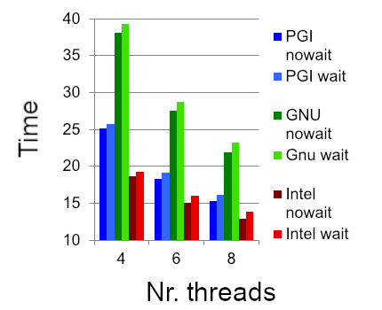
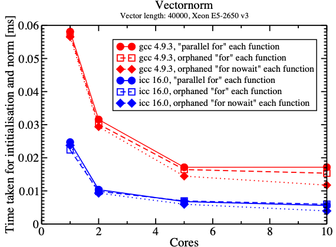

More on Worksharing
===================

.. objectives::

    This guide covers advanced worksharing concepts:

    - ``single`` and ``master`` constructs
    - ``if`` clause for conditional parallelization
    - Flushes and implicit barriers
    - ``nowait`` clause for removing barriers
    - Orphan directives

Work for Single Threads
-----------------------

The ``single`` Construct
^^^^^^^^^^^^^^^^^^^^^^^^

The ``single`` construct is a worksharing construct placed inside a parallel
region. Exactly one thread, not necessarily thread 0, executes its block.

- The executing thread is not specified.
- Other threads wait at an implicit barrier at the end, unless ``nowait`` is used.
- It is useful for operations that should be performed only once: updating
  shared metadata, performing one I/O operation, or creating tasks.

**Example: initializing a shared value once**

.. tabs::

   .. tab:: C/C++

      .. code-block:: c

         #pragma omp parallel shared(a, b, n)
         {
             #pragma omp single
             {
                 a = omp_get_num_threads();
             }  // implicit barrier

             #pragma omp for
             for (int i = 0; i < n; i++)
                 b[i] = a;
         }

   .. tab:: Fortran

      .. code-block:: fortran

         !$omp parallel shared(a, b, n) private(i)
             !$omp single
                 a = omp_get_num_threads()
             !$omp end single  ! implicit barrier

             !$omp do
             do i = 1, n
                 b(i) = a
             end do
         !$omp end parallel

.. note::

   The implicit barrier after ``single`` ensures that ``a`` has been set
   before threads enter the following worksharing loop. Do not add ``nowait``
   here without another suitable synchronization mechanism.

The ``master`` and ``masked`` Constructs
^^^^^^^^^^^^^^^^^^^^^^^^^^^^^^^^^^^^^^^

Unlike ``single``, ``master`` assigns the work to the primary thread
(thread 0) and has **no implicit barrier**. This avoids the barrier overhead
when synchronization is unnecessary. ``master`` is deprecated as of OpenMP
5.1; ``masked`` without a ``filter`` clause is its modern counterpart.

.. tabs::

   .. tab:: C/C++

      .. code-block:: c

         #pragma omp parallel
         {
             #pragma omp masked
             {
                 /* Executed by the primary thread only. */
             }
             /* No implicit barrier after masked. */
         }

      Older OpenMP code may instead use ``#pragma omp master``.

   .. tab:: Fortran

      .. code-block:: fortran

         !$omp parallel
             !$omp masked
                 ! Executed by the primary thread only.
             !$omp end masked
             ! No implicit barrier after masked.
         !$omp end parallel

      Older OpenMP code may instead use ``!$omp master`` / ``!$omp end master``.

.. note::

   The ``masked`` examples require a compiler supporting OpenMP 5.1 or later.
   Keep ``master`` if your HPC compiler only implements an older version.

The ``ordered`` Construct
^^^^^^^^^^^^^^^^^^^^^^^^^

An ``ordered`` region enforces sequential iteration order for a portion of
an otherwise parallel loop. The enclosing worksharing loop needs an
``ordered`` clause. The expensive calculation can run in parallel, while
output is produced in the original iteration order. In this simple form,
there must not be more than one ordered region associated with each loop
iteration.

.. warning::

   Ordering can be expensive. Use it only for the part of the computation
   that truly must follow the iteration order.

**Example: ordered output from a parallel calculation**

.. tabs::

   .. tab:: C/C++

      .. code-block:: c

         #pragma omp parallel for ordered schedule(dynamic, 1)
         for (int i = 0; i < PSIZE; i++) {
             b[i] = expensiveFunction(i);
             #pragma omp ordered
             {
                 printf("b[%3i] = %4i\n", i, b[i]);
             }
         }

   .. tab:: Fortran

      .. code-block:: fortran

         !$omp parallel do ordered schedule(dynamic, 1)
         do i = 1, PSIZE
             b(i) = expensiveFunction(i)
             !$omp ordered
                 print *, "b(", i, ") = ", b(i)
             !$omp end ordered
         end do
         !$omp end parallel do

The calls to ``expensiveFunction`` can execute concurrently; the print
statements execute in increasing iteration order. ``ordered`` is not a
substitute for protecting arbitrary shared-variable updates.

Clauses for the Parallel Construct
----------------------------------

The ``if`` Clause
^^^^^^^^^^^^^^^^^

The ``if`` clause controls whether a parallel construct uses multiple
threads. If the expression evaluates to false, the parallel region is
**serialized** and executes with one thread. This is useful when a workload
is too small to benefit from parallel execution.

.. tabs::

   .. tab:: C/C++

      .. code-block:: c

         int n = 20;
         #pragma omp parallel if (n > 5) shared(n)
         {
             #pragma omp single
             printf("The n is %i\n", n);

             printf("Hello, I am thread %i of %i\n",
                    omp_get_thread_num(), omp_get_num_threads());
         }

   .. tab:: Fortran

      .. code-block:: fortran

         integer :: n = 20
         !$omp parallel if (n > 5) shared(n)
             !$omp single
                 print *, "The n is:", n
             !$omp end single
             print *, "Hello, I am thread", omp_get_thread_num(), &
                      "of", omp_get_num_threads()
         !$omp end parallel

- If ``n > 5``, the runtime may use multiple threads.
- If ``n <= 5``, the region executes using a single thread.

The ``num_threads`` Clause
^^^^^^^^^^^^^^^^^^^^^^^^^^

The ``num_threads`` clause requests a team size for a particular parallel
region; the actual number can also depend on runtime limits and settings.
It takes precedence over the environment's default request for that region.

.. tabs::

   .. tab:: C/C++

      .. code-block:: c

         int nthread = 3;
         #pragma omp parallel num_threads(nthread)
         {
             /* Work performed by the team. */
         }

   .. tab:: Fortran

      .. code-block:: fortran

         integer :: nthread = 3
         !$omp parallel num_threads(nthread)
             ! Work performed by the team.
         !$omp end parallel

Keeping Memory Consistent
-------------------------

The OpenMP Memory Model
^^^^^^^^^^^^^^^^^^^^^^^

OpenMP has a relaxed-consistency memory model. A thread may have a temporary
view of shared variables, and access to shared memory may be reordered within
the constraints of the memory model. Correct communication between threads
requires suitable synchronization, such as barriers, critical regions, locks,
or atomics with appropriate memory ordering.

.. important::

   Do not assume that a value written by one thread is immediately visible
   to another. A plain ``flush`` is not a general substitute for mutual
   exclusion or an ordering protocol.

**Potential race with overlapping array updates**

.. tabs::

   .. tab:: C/C++

      .. code-block:: c

         int b[4] = {3, 4, 5, 6};
         #pragma omp parallel num_threads(3) shared(b)
         {
             int i = omp_get_thread_num();  // 0, 1, 2
             b[i]   = b[i] + (i + 1);
             b[i+1] = b[i+1] + 1;          // overlaps another thread
         }

   .. tab:: Fortran

      .. code-block:: fortran

         integer :: b(4) = [3, 4, 5, 6]
         integer :: i
         !$omp parallel num_threads(3) shared(b) private(i)
             i = omp_get_thread_num() + 1  ! 1, 2, 3
             b(i)   = b(i) + i
             b(i+1) = b(i+1) + 1           ! overlaps another thread
         !$omp end parallel

This is a data race: one thread may be modifying ``b(i+1)`` while another
modifies that same element. Merely flushing memory would **not** make the
compound updates atomic.

**Solution for this example: a barrier between two non-overlapping phases**

.. tabs::

   .. tab:: C/C++

      .. code-block:: c

         int b[4] = {3, 4, 5, 6};
         #pragma omp parallel num_threads(3) shared(b)
         {
             int i = omp_get_thread_num();
             b[i] = b[i] + (i + 1);
             #pragma omp barrier
             b[i+1] = b[i+1] + 1;
         }

   .. tab:: Fortran

      .. code-block:: fortran

         integer :: b(4) = [3, 4, 5, 6]
         integer :: i
         !$omp parallel num_threads(3) shared(b) private(i)
             i = omp_get_thread_num() + 1
             b(i) = b(i) + i
             !$omp barrier
             b(i+1) = b(i+1) + 1
         !$omp end parallel

For exactly three threads, the phases are:

.. code-block:: text

   Initial:                       [3, 4, 5, 6]
   After phase 1 (before barrier): [4, 6, 8, 6]
   After phase 2:                  [4, 7, 9, 7]

.. note::

   The barrier ensures that all updates in phase 1 complete before phase 2
   begins. Within each phase, different threads write distinct elements.
   This particular indexing assumes exactly three threads.

Ensuring Memory Consistency: ``flush``
^^^^^^^^^^^^^^^^^^^^^^^^^^^^^^^^^^^^^^

A ``flush`` participates in establishing consistency between threads'
views of memory. A release/acquire synchronization relationship, or an
appropriate synchronization construct, is needed for reliable publication
of a value between threads. The usual communication sequence is: the
producer writes, the producer performs a release operation, the consumer
performs a synchronizing acquire operation, and the consumer reads the
published data. In practice, prefer a barrier or an atomic protocol over
hand-written spin loops with explicit flushes.

**Explicit flush syntax**

.. tabs::

   .. tab:: C/C++

      .. code-block:: c

         #pragma omp flush

   .. tab:: Fortran

      .. code-block:: fortran

         !$omp flush

**Ordered publication using release/acquire atomics (OpenMP 5.0+)**

The following alternatives demonstrate a writer publishing ``a[4]`` /
``a(5)`` and a reader waiting for a notification flag. An atomic write
with ``release`` followed by a corresponding atomic read with ``acquire``
orders the data access across the two threads.

.. tabs::

   .. tab:: C/C++

      .. code-block:: c

         double a[5] = {0};
         int matrix_set = 0;
         #pragma omp parallel num_threads(2) shared(a, matrix_set)
         {
             if (omp_get_thread_num() == 0) {
                 a[4] = 3.0;
                 #pragma omp atomic write release
                 matrix_set = 1;
             } else {
                 int seen = 0;
                 while (!seen) {
                     #pragma omp atomic read acquire
                     seen = matrix_set;
                 }
                 printf("a[4] = %g\n", a[4]);
             }
         }

   .. tab:: Fortran

      .. code-block:: fortran

         real :: a(5)
         integer :: matrix_set, seen
         a = 0.0
         matrix_set = 0
         !$omp parallel num_threads(2) shared(a, matrix_set) private(seen)
             if (omp_get_thread_num() == 0) then
                 a(5) = 3.0
                 !$omp atomic write release
                 matrix_set = 1
             else
                 seen = 0
                 do while (seen == 0)
                     !$omp atomic read acquire
                     seen = matrix_set
                 end do
                 print *, "a(5) =", a(5)
             end if
         !$omp end parallel

.. warning::

   The original version (writing ``A(5)``, calling ``flush``, and setting a
   flag) does not by itself define a complete reader/writer protocol.
   Use an appropriate acquire operation on the reader side. Busy-waiting
   is for demonstration only, not generally the best design for HPC code.

Implicit Synchronization
^^^^^^^^^^^^^^^^^^^^^^^^

OpenMP includes synchronization and associated memory-consistency effects
at many constructs, for example:

- The end of a ``parallel`` region has an implicit barrier.
- ``barrier`` is an explicit team synchronization point.
- Worksharing ``for``/``do``, ``sections``, ``single``, and Fortran
  ``workshare`` normally have an implicit barrier at the end, unless
  ``nowait`` removes it.
- ``critical`` coordinates mutually exclusive entry and exit.
- ``atomic`` coordinates access to the specified storage location;
  memory-order clauses determine further ordering guarantees.

The deprecated ``master`` construct and the corresponding ``masked``
construct have no implicit barrier on exit.

Clause: ``nowait``
------------------

Implicit barriers can add overhead when threads do not need to wait for one
another. ``nowait`` removes the implicit barrier at the end of an eligible
worksharing construct, but it must not violate dependencies between work
performed by different threads.

.. tabs::

   .. tab:: C/C++

      Add ``nowait`` to the worksharing directive:

      .. code-block:: c

         #pragma omp for nowait
         for (int i = 0; i < n; i++)
             a[i] = funcA(i);

   .. tab:: Fortran

      Put ``nowait`` on the corresponding end directive:

      .. code-block:: fortran

         !$omp do
         do i = 1, n
             a(i) = funcA(i)
         end do
         !$omp end do nowait

**Example: producing two vectors before using both**

.. tabs::

   .. tab:: C/C++

      .. code-block:: c

         #pragma omp parallel shared(a, b, t, n)
         {
             #pragma omp for nowait
             for (int i = 0; i < n; i++)
                 a[i] = sin((double)i);

             #pragma omp for
             for (int i = 0; i < n; i++)
                 b[i] = cos((double)i); // implicit barrier

             #pragma omp for
             for (int i = 0; i < n; i++)
                 t[i] = a[i] + b[i];
         }

   .. tab:: Fortran

      .. code-block:: fortran

         !$omp parallel shared(a, b, t, n)
             !$omp do
             do i = 1, n
                 a(i) = sin(real(i))
             end do
             !$omp end do nowait

             !$omp do
             do i = 1, n
                 b(i) = cos(real(i))
             end do
             !$omp end do   ! implicit barrier

             !$omp do
             do i = 1, n
                 t(i) = a(i) + b(i)
             end do
         !$omp end parallel

The first loop initializes ``a`` without a barrier. The **second** loop
initializes ``b`` and has a barrier, which ensures that *both* preceding
loops have completed before the third loop uses their results. Combining
these operations in one loop would often be faster; this is a demonstration
of synchronization rather than a performance recommendation.

**Example: tensor product, with the dependency correctly synchronized**

The original C example was labeled as having a bad access to ``b`` even
though the barrier after its second loop also guarantees completion of the
first loop. The following paired examples make that dependency explicit.

.. tabs::

   .. tab:: C/C++

      .. code-block:: c

         #pragma omp parallel shared(a, b, t, n, m)
         {
             #pragma omp for nowait
             for (int i = 0; i < n; i++)
                 a[i] = funcA(i);

             #pragma omp for
             for (int j = 0; j < m; j++)
                 b[j] = funcB(j);  // barrier synchronizes both arrays

             #pragma omp for
             for (int i = 0; i < n; i++)
                 for (int j = 0; j < m; j++)
                     t[i][j] = a[i] * b[j];
         }

   .. tab:: Fortran

      .. code-block:: fortran

         !$omp parallel shared(a, b, t, n, m)
             !$omp do
             do i = 1, n
                 a(i) = funcA(i)
             end do
             !$omp end do nowait

             !$omp do
             do j = 1, m
                 b(j) = funcB(j)
             end do
             !$omp end do   ! synchronizes both arrays

             !$omp do
             do j = 1, m
                 do i = 1, n
                     t(i,j) = a(i) * b(j)
                 end do
             end do
         !$omp end parallel

Performance Impact of ``nowait``
^^^^^^^^^^^^^^^^^^^^^^^^^^^^^^^^

The original training benchmark used a dual-socket, quad-core Intel Xeon
E5520 (2.26 GHz) with PGI 10.9, GCC 4.4, and Intel 12.0. It measured
vector addition with ``n = 1000`` and 4, 6, or 8 threads.

.. code-block:: text

   Threads     Reported savings from nowait
   4--8        0.6--1.3 microseconds

.. note::

   These numbers are historical, platform-specific results, not general
   performance guarantees. Even small improvements can matter in loops
   executed very frequently.

Specialty of ``schedule(static)``
---------------------------------

For multiple worksharing loops associated with the **same parallel region**,
matching iteration counts, compatible bounds, and identical static schedules
(including chunk size) can assign corresponding logical iterations to the
same threads. Under these conditions, later loops can consume values written
by the same threads without an intervening worksharing barrier.

.. important::

   This depends on the prescribed static-iteration mapping. Do not apply
   it to ``dynamic`` or ``guided`` scheduling, or when iteration spaces
   or scheduling parameters differ. A loop still needs the appropriate
   synchronization for other dependencies.

**Example: corresponding iterations handled by the same thread**

.. tabs::

   .. tab:: C/C++

      .. code-block:: c

         #pragma omp parallel shared(a, b, t, n)
         {
             #pragma omp for schedule(static) nowait
             for (int i = 0; i < n; i++)
                 a[i] = sin((double)i);

             #pragma omp for schedule(static) nowait
             for (int i = 0; i < n; i++)
                 b[i] = cos((double)i);

             #pragma omp for schedule(static)
             for (int i = 0; i < n; i++)
                 t[i] = a[i] + b[i];
         }

   .. tab:: Fortran

      .. code-block:: fortran

         !$omp parallel shared(a, b, t, n)
             !$omp do schedule(static)
             do i = 1, n
                 a(i) = sin(real(i))
             end do
             !$omp end do nowait

             !$omp do schedule(static)
             do i = 1, n
                 b(i) = cos(real(i))
             end do
             !$omp end do nowait

             !$omp do schedule(static)
             do i = 1, n
                 t(i) = a(i) + b(i)
             end do
         !$omp end parallel

In each loop, the same thread handles a given index. For example,
under the specified equal static schedules, a thread responsible for
index ``i`` in the first loop is responsible for that same index in the
second and third loops. Therefore its read of ``a`` and ``b`` occurs
after its own writes to those elements. The
final implicit barrier at the end of the ``parallel`` region still applies.

Orphan Directives
-----------------

An *orphan directive* is an OpenMP directive in a called function or
subroutine, rather than lexically inside the ``parallel`` region. Such a
directive can bind to the active parallel region in which it is called.
Procedures called by the team must be thread-safe, and all the threads
required by a worksharing or barrier construct must encounter it in a
compatible order.

**Example: a routine with an orphaned worksharing loop**

.. tabs::

   .. tab:: C/C++

      Main function (illustrative excerpt):

      .. code-block:: c

         double v[8];
         #pragma omp parallel shared(v)
         {
             vectorinit(v, 8);
         }

      Called function:

      .. code-block:: c

         void vectorinit(double *vdata, int leng)
         {
             #pragma omp for
             for (int i = 0; i < leng; i++)
                 vdata[i] = (double)i;
         }

   .. tab:: Fortran

      Main program (illustrative excerpt):

      .. code-block:: fortran

         double precision :: v(8)
         !$omp parallel shared(v)
             call vectorinit(v, size(v))
         !$omp end parallel

      Called subroutine:

      .. code-block:: fortran

         subroutine vectorinit(vdata, leng)
             integer, intent(in) :: leng
             double precision, intent(inout) :: vdata(leng)
             integer :: i
             !$omp do
             do i = 1, leng
                 vdata(i) = dble(i - 1)
             end do
             !$omp end do
         end subroutine vectorinit

.. note::

   Every thread calls the routine, but its orphaned ``for``/``do``
   distributes the loop across the team. The examples set the vector to
   values 0 through 7. The original sample also called a ``vectornorm``
   function, but did not provide its implementation; this example isolates
   the orphaned directive so the synchronization is unambiguous.

Performance Impact of Orphaning
^^^^^^^^^^^^^^^^^^^^^^^^^^^^^^^

The original benchmark compared vector initialization and norm calculation
for a vector of length 40,000, on a Xeon E5-2650 v3 using GCC 4.9.3 and
ICC 16.0. It compared:

1. Starting a separate parallel region in each routine.
2. Using orphaned ``for``/``do`` in a longer parallel region.
3. Using orphaned worksharing loops with ``nowait`` where safe.

The reported benchmark favored reusing one long parallel region, with
additional savings from removing unnecessary barriers.

Discussion of Orphan Directives
^^^^^^^^^^^^^^^^^^^^^^^^^^^^^^^

**Advantages**

- Existing functions can be parallelized without rewriting every call site.
- Longer parallel regions avoid repeated team setup costs.
- Reducing barriers can improve performance when dependencies allow it.

**Potential pitfalls**

.. warning::

   A routine containing orphan directives may behave differently when
   called from serial code. For example, its worksharing construct can
   run with a single thread, and a barrier inside it must be encountered
   consistently by the expected team. Document the required calling
   context, and design/test serial and parallel usage deliberately.

.. challenge::

    Inspect and run the following code where an orphan directive is used in *func1*

    .. code-block:: c
        :linenos:

        // On cluster Kebnekaise
        // ml foss
        // export OMP_NUM_THREADS=1 
        // gcc -O3 -march=native -fopenmp -o test.x 4-static-orphaned-openmp.c -lm 
        #include <stdio.h>
        #ifdef _OPENMP
        #include <omp.h>
        #endif

        int func1(int var2)
        {
        int i;  
        var2 = 0;

        for ( int i = 0; i < 10; i++)
        #pragma omp atomic update
                var2 += 1;

        return var2;
        }

        int main()
        {

        int i,var1,var2;  
        var1 = 0;

        // Static extent

        #pragma omp parallel 
            {
            
        #ifdef _OPENMP
        #pragma omp for reduction(+:var1)
            for ( int i = 0; i < 10; i++)
                var1 += 1;
                
        #else
            printf("Serial code!\n");
        #endif
            }
        
            printf("Static version: var1 =  %i \n", var1);

        // Dynamic extent
        int result = 0;
        #pragma omp parallel reduction(+:result)
            {
            result += func1(var2); 
        #ifdef _OPENMP
        #else
            printf("Serial code!\n");
        #endif
            }

            printf("Dynamic version: result =  %i \n", result);     

        return 0;
        }

Summary
^^^^^^^

This guide covered advanced worksharing concepts in OpenMP:

**Constructs**

- **single construct:** Execute code on one thread (with barrier)
- **master construct:** Execute code on master thread (no barrier)
- **ordered construct:** Execute loop iterations in sequential order

**Clauses**

- **if clause:** Conditional parallelization
- **num_threads clause:** Control thread count
- **nowait clause:** Remove implicit barriers for performance

**Memory Consistency**

- **flush:** Ensure memory consistency across threads
- **Implicit barriers and flushes:** Automatic synchronization points
- **Memory reordering:** Understanding and preventing issues

**Advanced Techniques**

- **Static schedule specialty:** Using nowait with dependencies
- **Orphan directives:** Worksharing constructs in called functions

**Performance Considerations**

- Balance between synchronization overhead and correctness
- Strategic use of ``nowait`` can improve performance
- Orphan directives reduce parallel region overhead
